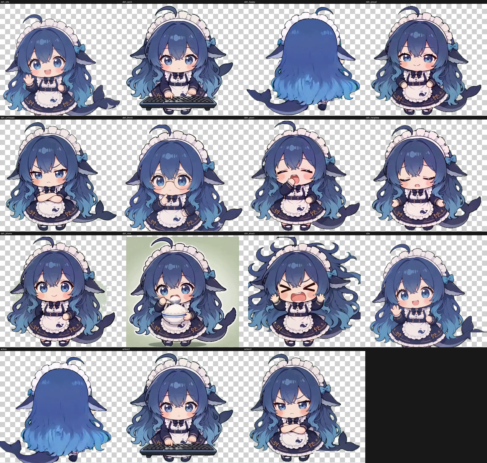

# zhiling · 桌面桌宠（DSMaid）

一只住在桌面右下角的绿幕抠像女仆：透明窗口、不抢焦点、按对话状态播动画。当前主线是 Python/Qt 版。



## 30 秒上手

```bash
cd deskpet-python
uv sync
uv run python pet.py --width 300
```

没有 uv 时用 pip（仅当没有 uv）：`.venv\Scripts\pip.exe install -r requirements.txt`，再 `run.bat`。

## 目录结构

- `deskpet-python\` —— 主线：PyQt6 透明窗口、状态映射、素材工坊
- `packs\` —— 素材包（`manifest.json` / `clips.json` / `state-map.json` 进 git，帧外置）
- `material\` —— 原始绿幕 mp4（即梦/海螺生成，不入库）
- `docs\` —— 素材包规范、状态映射设计、截图
- `deskpet-tauri\` —— Tauri 版（单 exe + 外部 `assets\`）

## 素材

帧（`packs\<packId>\frames\`）和 mp4 都**不进 git**：按 `manifest.json` 记录的参数从 `material\` 重建，或从 Release 附件取。`packs` 是外置的，换素材不需要改代码、不需要重编译。

## License

代码：**GNU GPL v3.0**（全文见 `LICENSE`）。

素材（`packs\`、`material\` 与生成帧）**不适用 GPL**，各自独立授权（当前两个 pack 为 `all-rights-reserved`，来源见各自 `manifest.json` 的 `license`）。不要把代码协议套到素材上，也不要把不同来源的素材混进同一个单一许可的 pack。

## deskpet-tauri

单 exe 3.2MB + 外部 `assets\`（帧和 mp4 不在 exe 内）。构建：`cd deskpet-tauri && cargo build --release`（或 `build.bat`），把 `assets\` 放到 exe 同级，或设 `DESKPET_ASSETS`。

**编译已验证通过（用户实测）；运行期行为（菜单项、状态分档切换）未在本机自动化验证。** NSIS 安装包未产出。

实测：首帧 1240ms、内存 549.8MB（60s 待机口径）。

## 详细文档

- [deskpet-python/README.md](deskpet-python/README.md) —— 安装、运行、工坊、状态映射、排错
- [docs/material-packs.md](docs/material-packs.md) —— 素材包规范（画布、license、分发、工坊流程）
- [docs/action-conversation-mapping.md](docs/action-conversation-mapping.md) —— 10 状态映射与 DSH 事件契约
