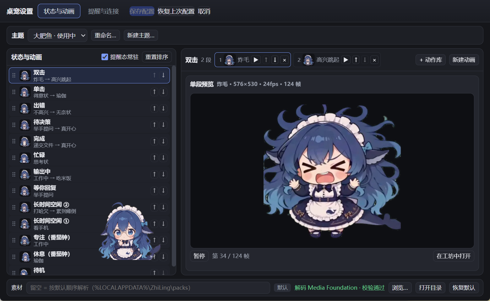
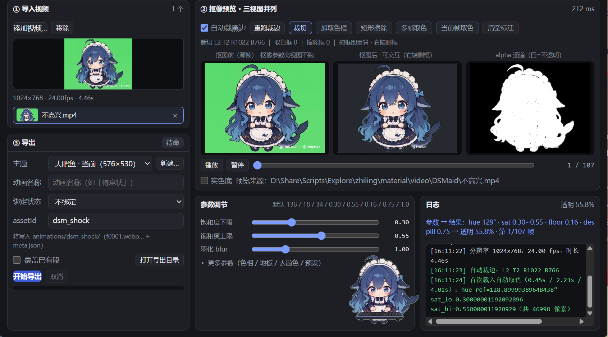

# zhiling · 智灵桌宠

一只住在桌面右下角的桌宠：透明窗口、不抢焦点、按对话状态播动画。仓库提供**两个等价实现**：

-   **Python 版**（`deskpet-python\`）：PyQt6，；
-   **Tauri 版**（`deskpet-tauri\`）：Rust + WebView2，。

两版共享同一份用户配置（`%LOCALAPPDATA%\ZhiLing\config.json`）、同一个素材目录（`%LOCALAPPDATA%\ZhiLing\packs`）与同一套主题/状态语义。

## 界面预览

| 桌宠桌面效果 | 桌宠设置 · 状态与动画 | 素材工坊 |
| --- | --- | --- |
|  |  |  |

- **桌宠桌面效果**：透明窗口的小女仆立在桌面右下角，不抢焦点，跟随对话状态播放动画。
- **桌宠设置 · 状态与动画**：左栏编排状态列表（可拖拽 / 上移下移 / 勾选启用），右栏编排每段动画并实时预览。
- **素材工坊**：导入绿幕视频 → 自动 / 手动抠像（原图 / 抠图后 / alpha 三视图实时预览）→ 导出为透明 WebP 帧序列。

## 素材来源与工作流

素材来自 **即梦 AI / MiniMax Design 生成的绿幕短视频**。整条链路是因果关系，不是功能罗列：

```
短视频（绿幕 mp4）
   │  ① 素材工坊 · （自动+可手动）裁黑边：整片统一裁一次（逐帧裁会让脚底抖）
   │  ② 素材工坊 · （自动+可手动）取绿幕色：四角取样 → hue_ref / sat 闸门
   │  ③ 素材工坊 · （自动+可手动）抠像：色相 + 饱和度 + 亮度三闸门 → alpha，去溢色、软地板、连通块清理
   │  ④ 素材工坊 · 生成 WebP：抠好的帧按脚底锚点对齐、缩放到 pack 画布
   ▼
packs\animations\<assetId>\f0000.webp …        （透明帧序列，不入库、可随时重建）
   │  ⑤ 状态绑定：themes\<id>.json 把 idle / busy / done / error … 指向 clipIds[]
   ▼
pet.py（Python 版） / ZhiLing.exe（Tauri 版）  →  桌宠
```

**视频是原料，工坊是加工厂，packs 是成品仓库，主题映射是接线图，桌宠程序是放映机。**

## 两个实现

### Python 版 `deskpet-python\`

**运行方式**

```powershell
cd deskpet-python
uv sync                                # Python ≥3.11，创建 .venv 并装依赖
uv run python pet.py --width 300       # 前台运行，便于看日志
run.vbs                                # 双击无黑窗（wscript 隐藏启动 pythonw）
run.bat                                # 备用，会闪约 0.5s cmd 窗口
```

**依赖**：PyQt6、Pillow、numpy、scipy、imageio-ffmpeg（自带 ffmpeg 二进制）、pypinyin。没有 uv 时可用 `pip install -r requirements.txt`。

**目录结构**

```
deskpet-python\
├─ pet.py                透明窗口、动作调度、右键菜单、托盘、番茄钟、设置窗
├─ state_map.py          状态映射加载与仲裁
├─ workshop\             素材工坊（GUI + 抠像核心 keyer.py / build_frames.py）
├─ packs\                成品素材包（可整体搬走）
├─ build\tools\          命令行工具（pack.py / dsh_bridge.py / make_icon.py / preview_key.py）
├─ build\cache\          抽帧、探针、日志等中间产物（不入库）
├─ sample_packs\sample\  随包最小示例（仅 idle，首启自动安装）
├─ tests\                纯逻辑测试，pytest -q
└─ assets\icon.ico       图标
```

**构建**：无需编译。`uv sync` 后直接运行；图标可用 `uv run python build\tools\make_icon.py` 重新生成。

**状态入口 / DSH 链路**

-   HTTP：`POST http://127.0.0.1:8766/state`（`--state-port` 打开，`0` 关闭）；
-   状态文件：`--state-file <路径>`，内容变化才应用；
-   DSH：默认在开端口时自动拉起 `build\tools\dsh_bridge.py`（订阅 `ws://127.0.0.1:55471` 广播 → POST `/state`），`--no-bridge` 可关；
-   装 DSH 插件不是必需：也可由 DSH 侧自己发 HTTP / 写状态文件。

**已知限制**：透明区域用 alpha 掩码近似「点穿」，仍会挡住一部分鼠标；工坊高级参数（`val_lo/val_hi/erode/keep_frac`）不暴露 UI；预览先缩长边到 560，边缘与全分辨率成品略有差异；素材水印只能盖掉、不能去除。本机实测首帧约 104ms、6 秒工作集约 56.9MB（`--width 300`）。

###   

### Tauri 版 `deskpet-tauri\`

**运行方式**：双击 `ZhiLing.exe`（放哪个目录都行），前置只有 `Microsoft Edge WebView2 Runtime`（Win10 1803+ / Win11 多数自带）。素材外置，不在 exe 内。

**依赖**：运行期只需 WebView2；构建期需要 Rust 工具链。

**目录结构**

```
deskpet-tauri\
├─ frontend\             手写 HTML/CSS/JS（直接作为 frontendDist 编译进 exe，无 npm/vite）
│  ├─ index.html         主窗口
│  ├─ settings.html      设置窗（状态与动画 / 提醒与连接 两页签）
│  └─ src\{main,settings,workshop,shared}.js
├─ src-tauri\
│  ├─ src\main.rs        窗口/托盘/设置/主题读写/外部状态入口
│  ├─ src\dsh.rs         DSH WebSocket 订阅（只读、断线重连）
│  ├─ src\workshop.rs    内置素材工坊（抠像/裁边/导出）
│  ├─ icons\             全部尺寸图标（由 build\make_icons.py 生成）
│  └─ tauri.conf.json
├─ build\prepare_assets.py   运行期素材准备（纯标准库）
└─ assets\               旧布局兜底（运行期素材默认在 ZhiLing 下）
```

**构建步骤**

```powershell
cd deskpet-tauri/src-tauri
cargo build --release 
```

**状态入口 / DSH 链路**：HTTP 与状态文件语义和 Python 版一致（`DESKPET_STATE_PORT` / `DESKPET_STATE_FILE`）；DSH 由 `src\dsh.rs` **直接订阅** `ws://127.0.0.1:55471`，不需要 Python 桥进程。

**已知限制**：素材工坊用系统 Windows Media Foundation 解码，只支持 mp4/mov 的 H.264/HEVC；webm/VP9/AV1 会提示转码或改用 Python 版工坊。NSIS/MSI 安装包尚未产出。透明区域同样是 alpha 掩码近似。release exe 约 3.92MB。

## DSH 插件：让桌宠跟着对话状态动

**怎么装**：DSH 设置 →「插件」→ 添加插件，箭头里选「安装第三方插件」，粘贴本机插件目录（如 `<仓库路径>\dsh-deskpet-bridge`；也接受 npm 包名或 Git 地址）。装完点「立即启用」，**重启 DSH Desktop** 才加载。端口默认 `55471`；要改就改插件配置的 `port`，并同步桥的 `--ws-port`。

插件源码就在本仓库：`dsh-deskpet-bridge\`（`index.js` / `package.json` / `cordis.patch.yml` / `locale\` / `icon.svg`），零依赖，clone 后可直接装，细节见其 [README](dsh-deskpet-bridge/README.md)。

**对两版的作用**：把 DSH 的对话流、工具调用、审批与选择题状态转成桌宠状态（`busy`/`streaming`/`done`/`error`/`needs_decision`）。Python 版经 `build\tools\dsh_bridge.py` 中转，`run.vbs --state-port 8766` 启动（默认自动接、`--no-bridge` 则关闭）；Tauri 版内置客户端，设置 →「提醒与连接」的 DSH 端口填 `55471`（填`0` 关闭）。

**两版可同时运行**：插件把事件广播给所有 WebSocket 客户端，两版各自跟随、互不干扰（端口已错开：Tauri `8765` / Python `8766`）。

三份日志（插件 `dsh_bridge_plugin.log`、桥 `dsh_bridge.log`、桌宠日志）统一 **2 MB + `.1`** 轮转，高频事件默认不落盘。事件映射表、`/health` 字段与排查步骤见 [deskpet-python/README.md](deskpet-python/README.md) 的 4.2 节。

## 共用

### 素材包

`packs\` 不随代码入库，单独打包为 zip 随 Release 附件分发（或从素材盘拷贝）。只克隆代码直接启动是没有完整素材的，但仓库内置最小示例 `deskpet-python\sample_packs\sample\`（约 3.7MB，仅 idle），首次启动找不到可用素材时会自动复制到 `%LOCALAPPDATA%\ZhiLing\packs`，逐文件复制、已存在的一律跳过、绝不覆盖用户数据。

推荐安装步骤：

1.  下载 `packs.zip`；
2.  解压到 `%LOCALAPPDATA%\ZhiLing\packs`（`ZhiLing` 目录不存在时先建）；
3.  解压后该目录应**直接**能看到 `active.json`、`themes\`、`animations\`； ⚠ 不要多套一层：`packs\packs\active.json`、`packs\deskpet-packs\active.json` 都算解压层级错误；
4.  启动 `run.vbs`（Python 版）或 `ZhiLing.exe`（Tauri 版）。

素材也可以在设置中调节放在别处。

### License

代码：**GNU GPL v3.0**（全文见 `LICENSE`）。

素材（`material\`、`packs\` 与生成帧）**不适用 GPL**，各自独立授权（当前两个 pack 为 `all-rights-reserved`，来源见各自 `manifest.json` 的 `license`）。不要把代码协议套到素材上，也不要把不同来源的素材混进同一个单一许可的 pack。

## Powered By TRAE

@highwindmx