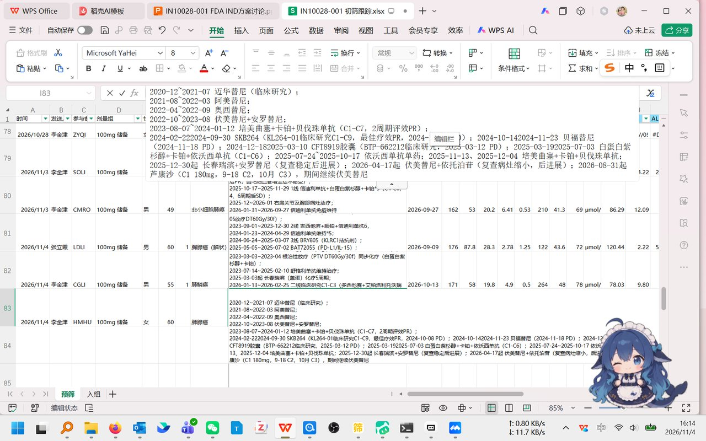
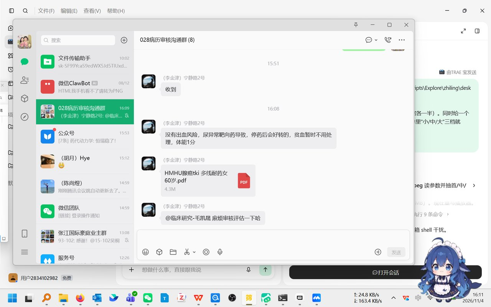
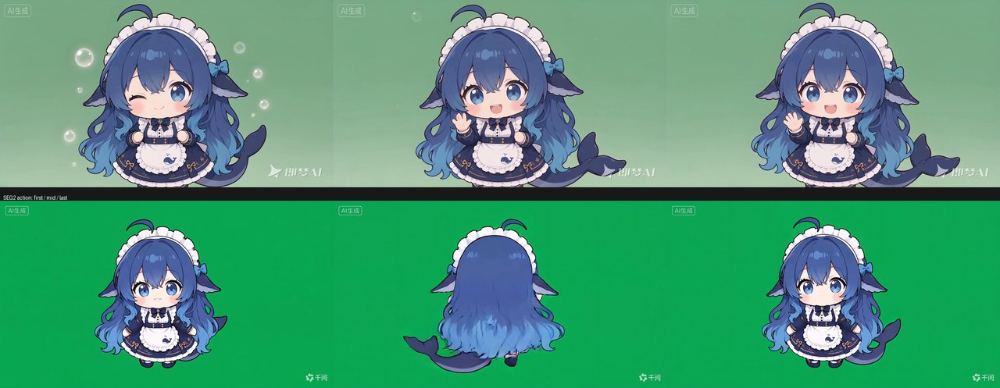
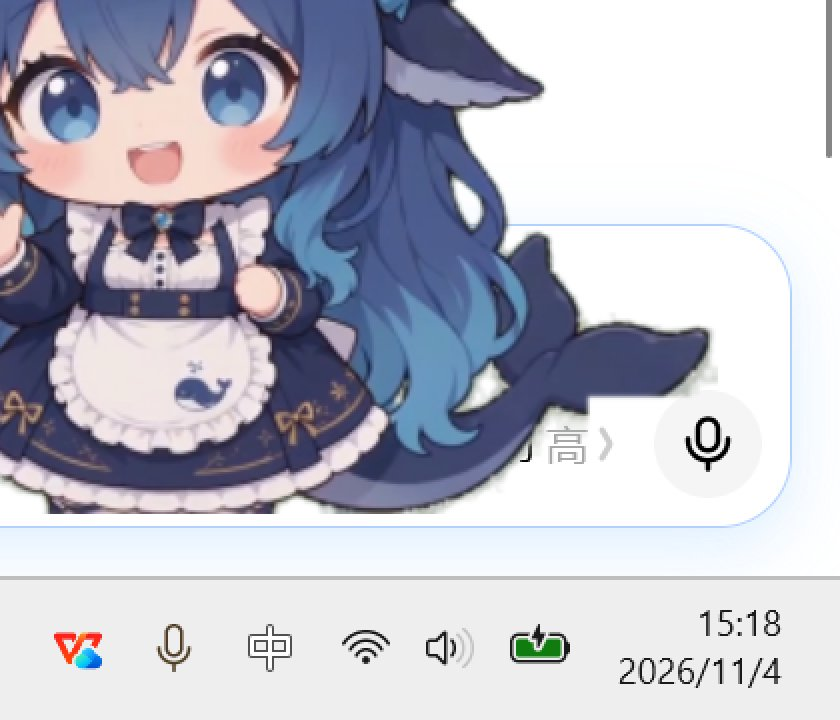
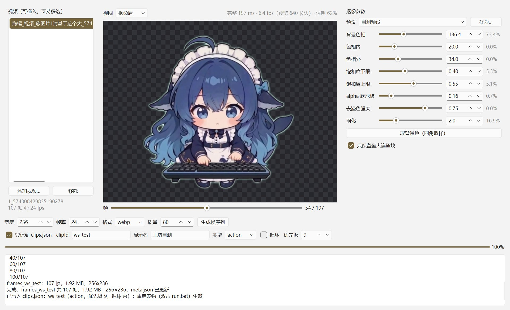

# 桌宠 · 蓝鲸女仆（deskpet-python）

把绿幕视频抠成透明帧序列，用 PyQt6 无边框窗口贴在桌面上循环播放。双击宠物按顺序播放下一个动作段，播完自动交叉淡化回待机；右键可以直接选某个动作。

- 纯 Python，一个窗口，无托盘、无网络；动作播放由 `state-map.json` 的**状态映射**驱动（见「状态映射」）
- **15 段素材**：1 段默认待机 + 10 个动作 + 4 段旧素材（原四段），全部登记在 `clips.json`（`defaultIdle` 决定用哪段待机）
- **自带素材工坊**：图形界面调抠像参数、看三视图、生成帧序列，换视频不用改代码
- 三档尺寸，拖到哪就待在哪

## 效果

桌面上（右下角，中档）：



双击后的动作段（播完自动回待机）：



既有两段素材的原始画面对比（角色同一，机位/缩放/绿幕不同）：



抠像边缘放大看（棋盘格 = 透明区）：



素材工坊（`workshop.bat`）：左边选视频、中间三视图、右边参数带"受影响像素百分比"：



## 快速开始

前置：Windows 10/11 + Python 3.11 以上。仓库里**不含帧序列**（11 段约 53MB，故意不入库），第一次跑要先重建或从 Release 附件下载，大约几分钟。

```bat
cd deskpet-python

:: 1) 装依赖（推荐 uv：uv.lock 保证版本一致）
uv sync
:: 没有 uv 才用 pip 这条路：
::   python -m venv .venv
::   .venv\Scripts\pip install -r requirements.txt -i https://mirrors.cloud.tencent.com/pypi/simple

:: 2) 重建帧序列（只需一次；已从 Release 下载 packs/ 的可跳过）
uv run python build\build_frames.py

:: 3) 启动
run.bat
```

也可以直接命令行启动：

```bat
uv run python pet.py
uv run python pet.py --width 500      :: 固定像素宽度，忽略档位
uv run python pet.py --log build\startup.log   :: 记录首帧时间/内存，用于测性能
```

已装好 `.venv` 的老用户把上面的 `uv run python` 换成 `.venv\Scripts\python.exe` 即可，两条路径等价。

### 安装依赖（uv 优先）

- **uv**：`uv sync`（在 `deskpet-python` 目录下）。`uv.lock` 已入库，能复现同一套版本；`uv sync` 默认就写进 `.venv`，**只有这一个环境**。`pyproject.toml` 里设了 `link-mode = "copy"`：本机 uv 缓存带着 `Everyone:(DENY)(DC)` 的 ACL，默认 hardlink 会让 `.venv` 里的文件也继承它，以后删环境会「拒绝访问」。
- **pip 备选（仅当没有 uv）**：`python -m venv .venv` → `.venv\Scripts\pip install -r requirements.txt`。
- `.venv\requirements.txt` 标为 **legacy**：uv 路径不需要它，别两条路径混用（同一个解释器装两遍容易版本打架）。

### 素材目录与迁移

帧现在按 pack 组织：`packs/<packId>/{manifest.json, clips.json, frames/<clipId>/}`。老仓库里扁平的 `deskpet-python/frames_*` 还没迁就运行 `uv run python build\migrate_packs.py --dry-run` 看计划，再去掉 `--dry-run` 执行（移动不复制，旧清单备份到 `packs/.legacy/`）。没迁移也能跑：程序先找 `packs/`，找不到才回退旧的 `frames_*` 并在启动日志里提示。

当前有两个 pack：

| packId | 内容 | 段数 |
|---|---|---|
| `maid-dsh` | DSMaid 系列（待机/工作中/真开心/不高兴/思考/打哈欠/无奈/看手机/吃米饭/炸毛/得意） | 11 |
| `maid-basic` | 第一批素材（待机/挥手/打字/抱臂） | 4 |

用哪个由 `packs/active.json` 决定（默认 `maid-dsh`，改一行即可切换）。


默认中档：宽度 = 可用屏幕宽的 15%。启动位置在屏幕右下角。

## 操作

| 操作 | 效果 |
|---|---|
| 左键拖动 | 移动位置 |
| 双击 | 走 `double_click` 状态映射（大默认「炸毛」）；状态映射没配时退回"播下一个动作" |
| 右键 → 动作：`displayName` 列出的动作 | 直接播指定动作（不经过状态映射） |
| 右键 → 素材工坊… | 拉起 `workshop.bat`（uv 优先，没有 uv 用 `.venv`；都找不到会弹窗说明怎么装） |
| 右键 → 尺寸：小 / 中 / 大 | 屏幕宽的 10% / 15% / 30% |
| 右键 → 退出 | 关闭 |
| `Esc` | 关闭（需先点一下宠物让窗口拿到焦点） |

没有任务栏图标，`run.bat` 用 `pythonw` 启动，不弹控制台窗口。

## 状态映射（哪个状态播哪个动作）

所有"什么时候自动播什么"都由当前 pack 的 `packs\<packId>\state-map.json` 决定（默认 `packs\maid-dsh\state-map.json`），**改完保存就生效**（1s 轮询 + 内容比对 + 800ms 去抖；
解析失败保留上一版并提示，坏的某一条只废自己）。tauri 版读的是同一份文件的副本（`assets\state-map.json`），字段语义完全一致。

| 状态 | 进入条件 | 默认动作 | priority |
|---|---|---|---|
| `idle` | 默认 | 待机 `dsh_idle`（循环） | 0 |
| `long_idle` | 10 分钟无交互 | 打哈欠 `dsh_yawn`（只播一次） | 10 |
| `awaiting_user` | `done` 后 30s 用户没再输入 | 看手机 `dsh_phone`（只播一次，不常驻） | 25 |
| `streaming` | 流式输出中 | 工作中 `dsh_work`（循环） | 30 |
| `busy` | 模型在忙、还没有首 token | 思考状 `dsh_think`（循环） | 35 |
| `done` | 本轮完成 | 真开心 `dsh_happy` | 45 |
| `needs_decision` | 需要你确认/选择 | 无奈状 `dsh_helpless`（一次 + 每 75s 轻提醒 ×3） | 55 |
| `error` | 出错 / 流式超时 | 不高兴 `dsh_unhappy` | 60 |
| `click` | 单击 | 得意状 `dsh_proud` | 70 |
| `double_click` | 双击 | 炸毛 `dsh_shock` | 85 |

- **priority 越大越能打断**：只有严格大于当前动作的 priority 才能插队；`interruptible=false` 的动作必须播完。
- 两个提醒态支持 `repeat: {mode:"once"|"interval", intervalSec, maxTimes}`；**其它状态写了 interval 会按 once 忽略**。
- `needs_decision` 现在**没有可靠事件源**（DSH 只广播 `welcome/status/token/done/error`），需要 DSH 补 `attention` 事件；
  当前只是占位实现（默认 `enabled:true` 但在没有外部事件时不会被触发，命令行可用 `--state` 手工验证）。
- 调试：日志里每条形如 `状态 -> 命中 clipId/prio -> 播放 | 被拒(cooldown/busy/disabled)`，最近 20 条；`--log <文件>` 可落盘。
- 手工触发某个状态（排查用）：`.venv\Scripts\python.exe pet.py --state needs_decision`。


## 目录结构

```
zhiling/
├─ deskpet-python/            主程序
│  ├─ pet.py                运行时代码（窗口、播放、拖动、菜单）
│  ├─ state_map.py          状态映射（10 状态、三道闸、提醒态、20 条调试日志）
│  ├─ run.bat               双击启动宠物
│  ├─ workshop.bat          双击启动素材工坊（uv 优先，降级 .venv）
│  ├─ clips.json            当前 active pack 的运行时索引（由 build/pack.py 生成）
│  ├─ pyproject.toml        uv 依赖清单（Python ≥3.11）
│  ├─ uv.lock               锁定的依赖版本（入库，保证可复现）
│  ├─ requirements.txt      pip 依赖（legacy：仅在没装 uv 时用）
│  ├─ meta.json             旧清单（迁移后仅作兜底，正式信息在 packs/<pack>/manifest.json）
│  ├─ assets/               两段源视频（原文件名保留）
│  ├─ presets/              素材工坊参数预设（*.json，可随仓库共享）
│  ├─ build/                抠像与构建脚本
│  │  ├─ keyer.py           抠像核心（HSV 阈值 + 去溢色 + 连通域 + 羽化），命令行与工坊共用
│  │  ├─ build_frames.py    视频 → 帧序列 + meta.json（工坊生成也调它）
│  │  ├─ pack.py            pack 读写：manifest / clips.json / 备份 / 同步 runtime 索引
│  │  ├─ migrate_packs.py   旧扁平 frames_* → packs/<packId>/ 迁移（幂等，--dry-run）
│  │  ├─ workshop.py        素材工坊（单文件 PyQt6 界面，三步：导入/抠像/导出）
│  │  ├─ _accept.py         "默认值一次跑通"验收（得意状 30fps + 炸毛黑边绿幕）
│  │  ├─ compare_clips.py   判断新素材能不能接（机位/绿幕/人物一致性）
│  │  ├─ measure.py         干净进程下的启动耗时/内存
│  │  ├─ test_all.py        端到端自测（双击、右键选动作、拖动、切档）
│  │  └─ regress_keyer.py   抠像回归（同参数重跑，与已提交帧逐像素对比）
│  ├─ docs/screenshots/     效果截图（README 用）
├─ packs/
│  ├─ active.json           当前启用的 pack（{"pack":"maid-dsh"}）
│  ├─ maid-dsh/             manifest.json + clips.json + state-map.json + frames/<clipId>/（11 段，不入库）
│  ├─ maid-basic/           manifest.json + clips.json + frames/<clipId>/（4 段，不入库）
│  └─ .legacy/              迁移前的旧清单备份（meta.json / 旧 manifest，不入库）
└─ deskpet-demo/            早期网页原型（浏览器里跑的 canvas 版）
```

## 帧序列如何重建

```bat
.venv\Scripts\python build\build_frames.py
```

脚本在 `build\build_frames.py` 顶部写死了这些参数，改素材或改抠像效果就改这里：

| 常量 | 作用 |
|---|---|
| `IDLE_SRC` / `ACT_SRC` | 两段源视频路径（默认指向 `assets\`） |
| `IDLE_P` / `ACT_P` | 抠像参数：色相窗口 `hue_in/hue_out`、饱和度/亮度门槛、腐蚀、羽化、透明下限 `floor`、去溢色强度、要抹掉的水印矩形 |
| `ACT_SCALE` / `FOOT` | 动作段相对待机段的缩放，以及两段共用的脚底锚点（保证双击时人物不"跳"） |
| `CROP` / `OUT_W` / `CANVAS_H` | 待机段的裁切框、输出宽度、共同画布高度 |

产物：`frames_idle\f0000..f0095.webp`、`frames_action\f0000..f0120.webp`（576×530，带 alpha），外加刷新 `meta.json`。运行时只读这些帧文件，不再碰视频。

**注意**：不带参数跑只会重建 `idle` / `action` 两段，`meta.json` 是合并写入，不会动 `action2`/`action3` 这类其它条目；`clips.json` 也不会被改。要重建/新增其它段，走 `--spec` 或素材工坊：

```bat
:: 单段重建：spec 是 {"id","video","params","fps","width","fmt","quality"}
.venv\Scripts\python build\build_frames.py --spec build\spec_action3.json
```

### 输出格式与体积

默认输出 **WebP（有损 q80 + alpha）**，体积约为 PNG 的 1/7。旧两段 217 帧的 WebP 编码本身约 25 秒（单帧 110~130ms，`method=6`），抠像耗时另算：

| 格式 | 帧总体积 | 相对 PNG | 说明 |
|---|---|---|---|
| PNG（旧默认） | 63.90 MB | 100% | 无损，但半透明渐变让 PNG 几乎压不动，平均 300KB/帧 |
| **WebP q90** | 12.03 MB | 18.8% | 几乎无损 |
| **WebP q80（默认）** | **9.36 MB** | **14.6%** | 576px 下与 PNG 肉眼无差 |
| WebP q60 | 7.52 MB | 11.8% | 深色大面积区域能看到轻微色块 |

q80 的判断依据：同帧在 576px（磁盘原尺寸 1:1）、384px（大档）、192px（中档）三档显示宽度下与 PNG 对比，看不出差别；PSNR 39.3~41.9 dB（29dB 以下才明显）。想调就改 `build\build_frames.py` 顶部的 `OUT_FMT`（可改回 `"png"`）与 `WEBP_Q`。

**注意**：WebP 只省磁盘，不省内存——解码后同样是显示尺寸的 QImage，工作集与读 PNG 基本一样（实测 192px 53.3→54.0 MB，384px 63.9→65.9 MB）。播放器会优先找 `frames_*\f0000.webp`，没有就自动回退读 `.png`，老目录直接能用。

换角色/换视频的顺序建议：先跑 `build\compare_clips.py` 看新素材的绿幕色相和人物高度是否和现有一致，再调 `ACT_P`，用 `build\key_test_action.py` 出单帧试色卡确认边缘，最后 `build_frames.py` 全量。

## 素材工坊（图形界面 = 素材包编辑器）

不想改代码调参数时用它。双击 `deskpet-python\workshop.bat`（也可以从宠物右键菜单「素材工坊…」拉起）。工坊优先 `uv run`，没有 uv 用 `.venv`；两者都没有会明确提示怎么装，不会静默失败。

界面压成三步，一屏三块：

- **① 导入**：视频拖入/多选，列表显示时长/分辨率/fps；填中文显示名，`clipId` 由显示名自动生成（拼音 → ASCII，如 `得意状` → `de_yi_zhuang`；没装拼音库就 `clip_01` 递增），只读展示，手改在「高级参数」
- **② 抠像**：左边棋盘格画布，`原片 / 抠像后 / alpha` 三视图 + 帧滑杆；默认只露两个开关——`自动裁黑边`（默认开，裁掉区域画半透明红遮罩）和`取背景色（点四角取样）`；色相/饱和度/软地板/去溢色/羽化折叠在「高级」，带「恢复默认」
- **③ 导出**：只剩 `目标 pack`、`开始生成`、`取消`、`打开输出目录` + 进度/日志 + 结果摘要（N 帧 / MB / 脚底锚点 y / 残留绿边 % / scale / offset）

导出参数（画布 576×530、24fps、WebP q80）是 **pack 级固定值**，写在 `packs/<packId>/manifest.json`，导出页不再出现。画布只在「新建素材包」弹窗里问一次（packId / 角色名 / 画布），改画布会让 pack 里所有 clip 都要重抠，没有特别理由别改。

生成直接写进 `packs\<packId>\frames\<clipId>\`，同时合并 `manifest.json`；目标 pack 是当前 active pack 时会同步 `deskpet-python\clips.json`。同 `clipId` 重抠**覆盖**旧帧（旧帧进 `packs\<packId>\.backup\`，留最近 3 份），不产生 `_v2` 目录。

**默认值必须一次跑通**：拖进一个新视频、什么都不改、点生成，结果可用。验收脚本 `build\_accept.py` 用得意状（30fps→24）和炸毛（黑边+绿幕）各跑一遍，结果见 `docs\material-packs.md`。

拖动滑杆时用 320 长边快速预览，停手 400ms 后自动补一张 640 长边完整预览；真正生成用源分辨率，不受预览尺寸影响。

### 参数含义

| 参数 | 默认 | 作用 |
|---|---|---|
| 背景色相 | 136 | 绿幕色相（0-360°）。纯绿一般 120-150；点`取背景色`从四角取样 |
| 色相内 | 18 | 与背景色相差 ≤ 这个角度 → 判为背景 |
| 色相外 | 34 | 相差 ≥ 这个角度 → 判为前景，中间是软过渡 |
| 饱和度下限 | 0.30 | 饱和度过低（灰白）不算背景，保护白围裙 |
| 饱和度上限 | 0.55 | 要够饱和才算绿，压掉阴影里的淡绿 |
| alpha 软地板 | 0.16 | 低于此 alpha 直接归零，回收淡绿雾 |
| 去溢色强度 | 0.75 | 从绿通道扣掉绿边的比例 |
| 羽化 | 1.0 | alpha 边缘高斯模糊半径（像素） |
| 只保留最大连通块 | 开 | 关掉会保留零散碎片（气泡、噪点） |

### 批量流程

1. 多选拖入视频（一次排队，逐段处理）
2. 默认值直接点`开始生成`；不满意再点`取背景色`/看 alpha 视图调高级参数
3. 想复用风格就`存为…`存成预设（写到 `presets\<名>.json`），下个视频直接在下拉里选
4. 生成完会写入 `manifest.json` + `clips.json`，并在日志里打出帧数/体积/锚点/残留绿
5. **重启宠物（双击 `run.bat`）才生效**

**工坊不是运行时依赖**：桌宠运行只需要 `packs\<packId>\frames\`，工坊只是生成/改帧的编辑器。所以 Tauri 版单 exe 不带 Python，右键菜单里点「素材工坊…」时能找到 `workshop.bat` 就拉起，找不到就提示"该功能需要 Python 版工具"。


命令行仍可用 `build\build_frames.py --spec <json>`。两条路径共用 `keyer.key_frame` 与 `build_frames.build_clip`，工坊里没有第二份抠像实现；`build\regress_keyer.py` 会用同参数重跑一段与仓库里的帧逐像素对比，作为回归。

### 异常提示

- **视频打不开**：弹窗 + 日志。多半是文件损坏/被占用，或封装 ffmpeg 不认识
- **背景可能没抠净**：预览右上角出现`⚠ 透明 xx%`，表示判为背景的像素太少。确认是纯绿幕，或手动拖`背景色相`，在 alpha 视图里看边框
- **四角不够绿**：`取背景色`之后日志提示饱和度过低，说明背景不纯/不是绿幕，建议手动取色而不是靠自动取样
- **磁盘不足**：生成前剩余空间 < 300MB 会先弹窗确认

## 实现要点

- **抠像**：HSV 色相距离做软阈值（不是简单绿通道做差），再叠饱和度/亮度门槛压掉白色和阴影；透明下限 `floor=0.16` 让背景残留变成极淡而不是硬边；溢色按比例从绿通道扣掉。
- **构建期降采样**：源 1280×720 → 输出 576 宽的序列，运行时按档位再 `scaled()`，避免每帧从大图缩。
- **懒加载**：后台线程解码，只在播放窗口附近缓存（预取 8 帧、保留 14 帧），首帧同步加载保证立刻可见。
- **切换**：双击 → 用 `QPainter.setOpacity` 交叉淡化 250ms，不进状态机。

实测（同一台机器，中档 192px 宽）：

| | 首帧可见 | 工作集内存 |
|---|---|---|
| 旧版（384px，96 帧全量预载） | 0.6~1.0 s | 110 MB |
| 现在（中档 192px） | 0.18 s | 55 MB |
| 现在（大档 384px） | 0.20 s | 67 MB |

## 素材来源

| 文件 | 来源 |
|---|---|
| `assets\jimeng-2026-11-04-5883-帮我生成桌面桌宠，绿幕背景，方便进行透明视频转码.mp4` | 即梦 AI 生成（1280×720，4.1s，待机） |
| `assets\HappyHorse 1.1_1793774480874.mp4` | HappyHorse AI 生成（1280×720，5.2s，动作·挥手） |
| `海螺_视频_@图片1请基于这个大_574308429835190278.mp4` | MiniMax 海螺 AI（1024×768，4.5s，动作·打字） |
| `海螺_视频_@图片1请基于这个大_574308517059928070.mp4` | MiniMax 海螺 AI（1024×768，4.5s，动作·抱臂） |

后两段放在仓库根目录（`*.mp4` 被 `.gitignore` 排除，不入库）。它们和旧两段是同一角色，但构图变了（坐在桌前、镜头更近），绿幕也更饱和（色相 136.4° / 124.6°，旧两段是 137°/148°）——所以各自用了独立的 `hue_ref` 和更紧的饱和度阈值，不能直接套用旧参数。

两段都是 **AI 生成的视频素材**，人物形象、视频本身的权利归生成工具/账号方所有，本仓库只存放用于技术演示的抠像结果。**商用或再分发前请自行核对对应平台的条款**（是否有商用授权、是否需要保留 AI 生成水印等）。动作段原片右上/右下带有平台水印，构建脚本在水印矩形内做了透明化处理。

## 空白处穿透（点宠物=正常，点旁边透明区=直达下层窗口）

**做法**：`setMask(QRegion)`——把当前帧 alpha 降采样成 1/2 的二值掩码，按行把连续的不透明像素合并成矩形，`QRegion.united` 成一个区域，`setMask()` 在 Windows 上就是 `SetWindowRgn`。窗口区域之外既**不裁视觉**（区域就是宠物轮廓），也**不吃鼠标**（`WindowFromPoint` 直接跳过），所以拖动/双击/右键全部保留。

**为什么不用 `WA_TransparentForMouseEvents`**：它是窗口级的"全穿透"，开了以后宠物自己也点不到；换成"按像素切换"就得在每次 `WM_NCHITTEST` 里做判定。这条路试过：Qt6 在原生窗口层就处理掉了 `WM_NCHITTEST`，`QWidget.nativeEvent` 一次都收不到（并且 `super().nativeEvent()` 会 `0xC000041D` 崩），所以改用 `setMask`。

**掩码更新策略**（不每帧重算全图）：
- `MASK_DIV=2`、`MASK_ALPHA_MIN=8`，192×177 → 96×88 的 alpha 图；
- 缓存 key = `(clip, idx, width, height)`，只有帧/尺寸变了才重建；`MASK_REFRESH_MS=150` 再兜一层节流；
- 首圈待机 96 帧各建一次，回到第 0 帧后全部命中缓存。

实测（6 秒，中档 192px）：`mask_builds=26`、`mask_updates=33`、单次 0.95~1.12ms（均值 ~0.98ms）、6 秒累计 25ms ≈ 单核 0.4%；区域 108 个矩形。视觉代价：待机帧 1.44% 的像素被裁掉（被裁像素最大 alpha 238，即边缘一两层半透明像素），与原图并排看不出差别。

**实测**（真实光标 + `mouse_event`）：

| 检查 | 结果 |
| --- | --- |
| 身体单击 | 底层窗口**收不到** `mousedown` |
| 身体双击 | 收到 `dblclick` → 播放下一个动作（`action_start` 日志） |
| 身体拖动 | 窗口原点随光标位移 |
| 紧邻透明区单击 | 底层窗口**收到** `mousedown` |
| 四角空白 | `WindowFromPoint` 返回下层窗口 |
| 边缘 ±2px | 向内偏保守（`edge+2` 仍归宠物，不误判穿透） |

**局限**：`MASK_DIV=2` 带来最多 2px 的量化误差（宁可算命中）；`setMask` 是每帧级 API，若以后换成 4K 素材/大档，单次构建会涨到 4~6ms，届时要么降 `MASK_DIV` 要么只对"变化区域"重算。

## DSMaid 素材：11 段全部接入

`material\DSMaid\` 共 **11 段 mp4** + `提示词.txt` + 1 张参考图。逐段体检（首/中/尾帧拼图见 [docs/screenshots/dsmaid-contact-sheet.png](../docs/screenshots/dsmaid-contact-sheet.png)）：

| 视频 | 尺寸 / 帧率 / 时长 | 背景色相 | 主体高占比 | 处理要点 |
|---|---|---|---|---|
| 待机 | 1280×720 / 24 / 4.1s | 135° | 97.4% | 背景是"上绿下浅"渐变，`sat_lo` 降到 0.06 |
| 工作中 | 1024×768 / 24 / 4.46s | 135° | 86.6% | 和旧「打字」几乎同一机位（scale 0.772 vs 0.773） |
| 真开心 | 1280×720 / 24 / 5.16s | 148° | 78.7% | 角色占比偏小（scale 0.866），中段转身背对镜头 |
| 不高兴 | 1024×768 / 24 / 4.46s | 124° | 96.5% | 和旧「抱臂」同机位（scale 0.695 vs 0.694） |
| 得意状 | 832×480 / **30** / 4.0s | 138° | 96.3% | 30fps → 24fps（抽帧时统一） |
| 思考状 | 1112×834 / 24 / 4.1s | **98°** | 100%（贴边） | 单独采样阈值（与其它段差 ~50°，套别的参数会把发色一起抠掉） |
| 打哈欠 | 832×480 / 24 / 5.18s | 120° | 96.5% | — |
| 无奈状 | 832×480 / **30** / 4.0s | 141° | 100%（贴边+光晕） | 光晕用 `keep_frac=0.05` 只留最大连通块后自然消失 |
| 炸毛 | 832×480 / 24 / 5.18s | 96°（中间绿幕 + 两侧黑边） | 100% | 见下节「炸毛复核」 |
| 看手机 | 832×480 / 24 / 5.18s | 111° | 96.3% | 色相偏青 |
| 吃米饭 | 832×480 / 24 / 5.18s | 151° | 100%（左右**深绿**遮幅） | 见下节「黑边复核」 |

**炸毛复核结论（用户说"两侧黑边、中间绿幕，可用"——确认成立）**

- 扫法：逐帧按行/列扫"近黑且均匀"的边缘带（`DARK=38`、`DARK_STD=14`，1fps 采 5 帧）。
- **黑边宽度确实逐帧变化**：左 167~168px、右 171~172px，幅度 1~2px。
- 所以**不逐帧裁**：取全片并集 bbox 裁一次 `crop=(174, 0, 654, 480)`（左右两侧各多留 4~6px，把黑边的灰阶过渡也吃掉）。
  逐帧裁会让主体框宽度每帧差 2px，`scale` 跟着抖、脚底锚点也会左右晃。
- 裁完只对中间区域采样 `hue_ref=96° / sat (0.172,0.192) / val (0.348,0.468)`，再按统一画布做透明 padding 对齐脚底（`foot y=527`、`scale=1.1084`）。

**吃米饭复核**：遮幅是**深绿色**不是纯黑，`DARK=38` 完全扫不到（上一轮漏判就是这里）。改用 luma<70 的列扫描测出左 172 / 右 164~165，同样取并集裁一次 `crop=(174, 0, 665, 480)`。

**体积与质检总表**（WebP q80，576×530，24fps；`残留绿%`=仍带绿边的像素占比，`最大%`=单帧最差，`雾%`=0<semi<16 的半透明像素占比，`脚底 y` 是画布内锚点行）：

| clipId | 名称 | 帧数 | MB | 残留绿% | 最大% | 雾% | bodyH | 脚底 y | scale / offset |
|---|---|---|---|---|---|---|---|---|---|
| `dsh_idle` | 待机 | 96 | 3.89 | 0.01 | 0.03 | 1.6 | 481 | 528 | 0.683 / [-201, 37] |
| `dsh_work` | 工作中 | 107 | 5.16 | 0.09 | 0.10 | 2.2 | 519 | 527 | 0.775 / [-117, -33] |
| `dsh_happy` | 真开心 | 121 | 4.85 | 0.95 | 1.36 | 1.7 | 498 | 510 | 0.866 / [-218, -46] |
| `dsh_proud` | 得意状 | 96 | 4.26 | 0.49 | 0.55 | 2.1 | 511 | 526 | 1.106 / [-192, 7] |
| `dsh_unhappy` | 不高兴 | 107 | 4.51 | 0.57 | 0.66 | 1.6 | 520 | 527 | 0.699 / [-94, 0] |
| `dsh_think` | 思考状 | 97 | 4.15 | 0.05 | 0.09 | 1.3 | 504 | 527 | 0.605 / [-92, 24] |
| `dsh_yawn` | 打哈欠 | 124 | 5.43 | 0.16 | 0.19 | 2.3 | 510 | 527 | 1.099 / [-189, 7] |
| `dsh_helpless` | 无奈状 | 96 | 4.06 | 0.20 | 0.28 | 2.3 | 518 | 526 | 1.116 / [-183, 1] |
| `dsh_phone` | 看手机 | 124 | 6.17 | 0.12 | 0.14 | 3.4 | 512 | 527 | 1.104 / [-173, 7] |
| `dsh_rice` | 吃米饭 | 124 | 4.53 | 0.01 | 0.01 | 0.7 | 522 | 528 | 1.088 / [21, 7] |
| `dsh_shock` | 炸毛 | 124 | 6.30 | 0.24 | 0.28 | 2.9 | 521 | 527 | 1.108 / [22, 7] |
| **11 段合计** | | **1316** | **53.3** | ≤0.95 | ≤1.36 | ≤3.4 | | | |

加上旧 4 段（`idle/action/action2/action3`，19.6MB）后 **15 段共 72.9MB**（下载体积，WebP q80）。质检脚本：[build/qc_pack.py](build/qc_pack.py)（重新出表 + 棋盘格预览 `docs/screenshots/dsmaid-11-preview.png`）；黑边/色相体检：[build/analyze_pack.py](build/analyze_pack.py)；参数网格搜索：[build/search_keyer.py](build/search_keyer.py)。

**登记（`clips.json`）**：15 条全部登记，11 段新素材用 `dsh_*` 前缀 + 中文 `displayName`；顶层新增 `defaultIdle: "dsh_idle"`，
旧的 `idle` 改成 `type: "action"`、显示名「旧·待机」，所以两版都不再靠"第一个 `type=idle`"猜默认待机——
想换回旧待机只要改 `defaultIdle` 一行。右键菜单按 `displayName` 列出全部动作（之前无奈/吃米饭看不到就是因为没登记）。

```bat
cd deskpet-python
.venv\Scripts\python.exe build\build_dsmaid.py                 :: 全部 11 段
.venv\Scripts\python.exe build\build_dsmaid.py dsh_shock       :: 只重建某一段
```

## 已知限制

- **大档内存约 67MB**：3 倍宽度意味着 9 倍像素量，缓存帧数不变但每帧更大。想更省就用中档。
- **透明区域也接收点击**：已改为 `setMask()` 穿透（见「空白处穿透」）；代价是边缘最多 2px 量化误差与每次 ~1ms 的掩码构建。
- **待机循环首尾不无缝**：96 帧直接首尾相接，循环处有轻微跳帧（原片本来就首尾不闭合）。想彻底顺需要在 `build_frames.py` 里做首尾交叉淡化或乒乓播放。
- **只测了 Windows**：依赖 PyQt6 的 `FramelessWindowHint` + `WA_TranslucentBackground` 组合，macOS/Linux 未验证。
- **工坊预览是半分辨率**：拖动时最长边 320、停手后 640，机器忙时会掉到 10fps 左右；生成的帧永远是源分辨率，预览只影响调参手感。
- **动作段不是逐帧对齐的**：四段素材各自独立（机位、缩放、背景色不同），现在只统一了脚底锚点和输出画布；切换瞬间仍有轻微位移/比例跳变，要彻底消掉得同一机位重拍或做形变对齐。
- **没有托盘图标、开关机自启**，退出只能右键菜单或 `Esc`。

## License

代码部分采用 **Apache License 2.0**（全文见仓库根目录 [LICENSE](../LICENSE)）：可自由使用、修改、商用，需保留版权声明与许可声明。上面"素材来源"里的几段视频不在代码许可范围内。
