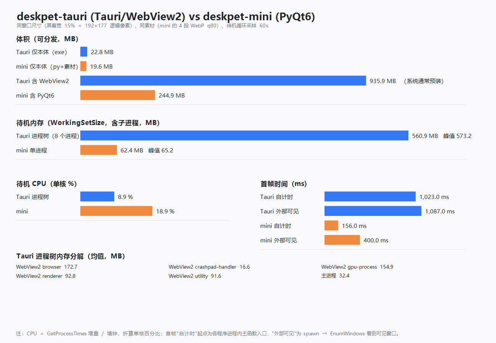
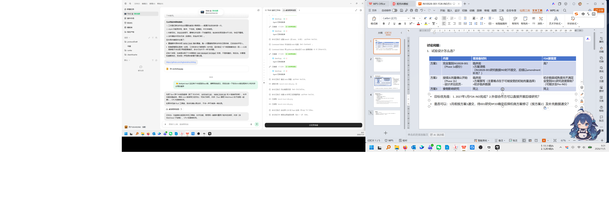
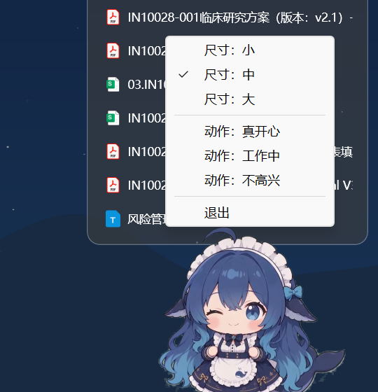

# 桌宠 · 蓝鲸女仆（deskpet-tauri）

Tauri 2 + 零构建前端的透明桌宠，与 [deskpet-mini](../deskpet-mini/)（PyQt6）**行为等价**：同一份素材、同一套尺寸/锚点换算、同样的拖动 / 双击轮播动作 / 原生右键菜单 / Esc 退出。这个目录本轮的目标是"跑起来 + 可测"，不含 DSH 对话桥接、托盘动画、多角色、AI 功能。

## 从零构建（`Cargo.toml` 在哪、要跑哪几条命令）

**先说位置：`Cargo.toml` 在 `deskpet-tauri\src-tauri\Cargo.toml`，不在 `deskpet-tauri\` 根目录。**
这是 Tauri 的固定布局：前端目录（`frontend/`）和 Rust crate（`src-tauri/`）平级，`Cargo.toml` 跟 crate 走。
所以直接 `cd deskpet-tauri && cargo build --release` 会报 `could not find Cargo.toml`，必须进 `src-tauri\` 或加 `--manifest-path`。

**前端不需要 `npm install` / `npm run build`**：`frontend/` 是零构建的 ES Module（没有 vite/webpack 编译步骤），
`package.json` 里的 `@tauri-apps/cli` 只在 `npm run build`（打 NSIS 安装包）或 `tauri dev` 时才用得到。
没有 Node 的环境照样能出 exe。

前置只有两样：Rust（stable，MSVC 工具链，含 VS Build Tools 的 C++ 桌面组件）+ Python 3（`prepare_assets.py` 只用标准库）。
另外素材前提：`deskpet-mini/frames_*` 已生成（帧序列不入库，见 [deskpet-mini/README.md](../deskpet-mini/README.md)）。

三条命令（在 `deskpet-tauri\` 下逐条执行）：

```bat
:: 1) 同步素材：把 deskpet-mini\frames_* 拷到 frontend-dist\assets，并生成合并版 clips.json
python build\prepare_assets.py
::    idle 96 / action 121 / action2 107 / action3 107 帧，canvas 576x530，共约 19.6MB

:: 2) 进 crate 目录再编译（.cargo/config.toml 的 crates.io 镜像只在 crate 目录内生效）
cd src-tauri
cargo build --release --target-dir %TEMP%\deskpet-tauri-target

:: 3) 运行产物
%TEMP%\deskpet-tauri-target\release\deskpet-tauri.exe
```

**为什么第 2 条要 `--target-dir %TEMP%`**：本仓库目录带 `Everyone Deny DeleteSubdirectoriesAndFiles` ACE，
cargo 增量构建时无法原子覆盖 `target\release\.fingerprint\*`，会直接报 `拒绝访问 (os error 5)`。
把 target 指到 `%TEMP%`（可写）就绕开了；不带这个参数时产物会落在 `src-tauri\target\release\deskpet-tauri.exe`（本机这条路会失败）。
想换位置：`set DESKPET_TARGET_DIR=D:\some\writable\dir`，`build.bat` 会读这个环境变量。

**`prepare_assets.py` 什么时候必须跑**：任何一次 `cargo build` 之前。原因有两条——
前端资源是**编译期**由 tauri-build 内嵌进 exe 的，运行时读不到 `../deskpet-mini/`；不跑这一步 `frontend-dist\` 不存在，编译会失败或内嵌不到素材（窗口起来是空的）。
换了素材（改 `clips.json`、重生成 `frames_*`）之后也要重跑，然后再 `cargo build`。

**一键脚本**：`build.bat`（在 `deskpet-tauri\` 根目录）等价于上面 1+2 两步，每步失败都会带原因停下、不吞错：

```bat
build.bat            :: release
build.bat debug      :: debug
```

`build.bat` 的产物同样在 `%TEMP%\deskpet-tauri-target\release\deskpet-tauri.exe`；它不会替你 `git push`，也不会打安装包（见「踩过的坑」第 8 条）。

## 运行

```bat
src-tauri\target\release\deskpet-tauri.exe
:: 或根目录 run.bat：给受限会话准备一个可写的 WebView2 用户目录
```

需要系统已安装 **WebView2 Runtime**（Win11 通常自带；本机为 156.0.4314.58）。窗口默认中档 = 屏幕可用宽 15%，贴在工作区右下角（逻辑边距 24 / 12）。

## 交互

| 操作 | 效果 |
| --- | --- |
| 左键拖动 | 原生拖动（`startDragging()`），停在哪待在哪 |
| 双击 | 待机时按 `priority` 播放下一个动作，播完交叉淡化回待机**续播位** |
| 右键 | 原生菜单：`尺寸：小/中/大`（当前档带 ✓）、`动作：真开心/工作中/不高兴`、`退出` |
| `Esc` | 退出 |

三档 = 屏幕可用宽的 10% / 15% / 30%，下限 140 逻辑像素（与 mini 的 `max(140, ...)` 一致）；切档保持窗口左上角，只有启动时贴右下角。

## 与 deskpet-mini 的差异

| 维度 | deskpet-mini（PyQt6） | deskpet-tauri |
| --- | --- | --- |
| 素材 | `frames_*/` + `meta.json`，WebP q80 | **同一份**（构建时由 `build/prepare_assets.py` 拷入并内嵌进 exe） |
| 帧清单 | `clips.json`（顺序/类型/名字）+ `meta.json`（帧数/fps/格式） | `frontend-dist/assets/clips.json` 一份自包含清单（生成物，不手改） |
| 播放 | `QTimer` 24fps，后台线程解码，缓存 ±14 帧 | `requestAnimationFrame` 24fps，`ImageBitmap` **整段常驻** |
| 交叉淡化 | `QPainter` opacity 250ms | 双 canvas 交叉 + CSS opacity 250ms |
| 尺寸/锚点 | `_resize_to(max(140, 屏宽×比例))`，右下 -24/-12 | 同一算法，但物理像素定位在 Rust 侧做（避开 WebView CSS/DPI 误差） |
| 右键菜单 | Qt 原生 `QMenu` | Tauri 原生 `Menu` + `popup_menu`（不用 HTML 菜单，避免被 192px 窗口裁切） |
| 拖动 | `mouseMoveEvent` 里 `move()` | `startDragging()`（由窗口管理器接管） |
| 退出 | 菜单 / `Esc` | 菜单 / `Esc` |

`clips.json` 没有直接复用 mini 那份，原因：mini 的清单只放 id/name/type/loop/priority，帧数/fps/格式散在 `meta.json` 里，且 mini 是本地 `open()` 读；前端只能 `fetch` 一个文件，所以由脚本合并成一份等价清单（字段语义一致，顺序/优先级/名字全部来自 mini）。

## 实测对比（同口径）

测量脚本：[build/bench.py](build/bench.py)（体积/内存/CPU/首帧）、[build/bench-chart.ps1](build/bench-chart.ps1)（出图）。

```bat
python build\bench.py --seconds 60
powershell -NoProfile -File build\bench-chart.ps1
```

条件：同窗口尺寸（中档 15% = 192×177 逻辑像素，物理 288×266）、同素材、待机循环采样 60s、Windows 11 本机（逻辑 1280×800 / 物理 1920×1200，150%）。

| 指标 | deskpet-tauri | deskpet-mini | 说明 |
| --- | --- | --- | --- |
| 仅程序本体 | **22.8MB**（单 exe） | 19.6MB（`pet.py` + 4 段帧） | 接近 |
| 含运行时依赖 | 935.9MB（exe + WebView2 Runtime 913.1MB） | 244.9MB（本体 + PyQt6 225.3MB） | WebView2 是系统级预装，通常不算应用体积 |
| 含完整 Python venv | — | 569.6MB | venv 含 pip/setuptools 等非必需包 |
| 待机内存（含子进程） | 560.9MB 均值 / 573.2MB 峰值（8 进程） | **62.4MB 均值 / 65.2MB 峰值**（1 进程） | 相差约 9 倍 |
| ├ 主进程 | 32.4MB | 62.4MB（全部） | Tauri 壳本身比 Qt 进程小 |
| ├ WebView2 browser | 172.7MB | — | Chromium 浏览器进程基线 |
| ├ WebView2 gpu-process | 154.9MB | — | 合成/纹理 |
| ├ WebView2 renderer | 92.8MB | — | 页面 + 96 帧位图 |
| ├ WebView2 utility（网络/存储等） | 91.6MB | — | |
| ├ WebView2 crashpad-handler | 16.6MB | — | |
| 待机 CPU（单核） | **8.9%** | 18.9% | mini 每帧重新解码 + 平滑缩放 |
| 首帧（进程内自计时） | 1023ms（同机多轮 0.67~1.99s 波动） | **156ms** | Tauri = WebView2 初始化 + 首帧解码 |
| 首帧（spawn → 窗口可见） | 1087ms | 400ms | 外部 `EnumWindows` 轮询 |
| 稳定性 | 60s 存活、无白底/黑屏/崩溃 | 同左 | 两端截图见下 |



差异来源：

- **体积**：Tauri 单 exe 几乎把"程序本体"压到和 mini 持平（22.8 vs 19.6MB），差距来自 Rust 静态链接 + WebView2 内核不在包内；只有把 WebView2 Runtime 也算进去时才会冲到 936MB，而这部分在 Win11 上是系统预装的。
- **内存**：差距**不是**页面泄漏，而是 WebView2 的多进程基线——browser/gpu/renderer/utility/crashpad 五个进程即使只画一个 192px 的宠物也要 ~500MB；Qt 单进程 62MB。Tauri 主进程本身只有 32MB，比 mini 还小。
- **CPU**：Tauri 反而更低，因为帧位图整段常驻、绘制只是 canvas blit；mini 每帧 `QImage` 解码 + `SmoothTransformation` 缩放，这是它 18.9% 的主要来源。
- **首帧**：Tauri 慢约 0.9s，来自 WebView2 运行时初始化（本机冷启动 670~1030ms 波动）；mini 直接读一帧就能显示。

## 放桌面上的效果

窗口裁剪（透明、无白底、无边框）：


整屏（右下角）：



原生右键菜单：



## 踩过的坑

1. **cargo 增量构建 `拒绝访问 (os error 5)`**：仓库目录带 `Everyone Deny DeleteSubdirectoriesAndFiles`，cargo 覆盖 `.fingerprint` 失败。解法是 `--target-dir %TEMP%\deskpet-tauri-target`（本轮的实测也是这样构建的）。
2. **透明窗口白闪**：`tauri.conf.json` 里 `visible: false`，前端解出首帧、画到 canvas 之后才调 `show_window`；同时 `shadow: false`、`decorations: false`。本机实测**没有**出现 1px 白边，也没有白闪。
3. **透明区域仍然吃鼠标**：矩形窗口会截获透明像素上的点击（与 mini 一致，本轮不做穿透）。用 `WindowFromPoint` 在宠物身体上取到的是 `msedgewebview2.exe` 的子窗口，说明命中测试正常、窗口不是点击穿透的。
4. **WebView2 GPU 进程内存暴涨（791MB）**：一开始待机每循环 96 帧都 `createImageBitmap` + `close()`，Chromium 的纹理回收有延迟，GPU 进程从 553MB 涨到 873MB。改成**整段预载并保留**后 GPU 稳定在 ~155MB，renderer ~93MB。
5. **动作播完回待机卡顿数秒**：切段时把待机位图也释放了，回待机要重解 96 帧。改为切段只释放上一段动作、待机段常驻（`dropOtherClips([IDLE_ID, id])`），回待机是瞬时的。
6. **HTML 右键菜单被窗口裁切**：192px 宽的无边框窗口放不下菜单，改用 Tauri 原生 `Menu` + `popup_menu`（菜单可以溢出窗口，靠近屏幕底部时会自动向上翻）。
7. **本会话无法注入真实鼠标**：`SetCursorPos` / `SendInput` 在这个会话里失效（光标被移到别处）。改用 WebView2 的 CDP（`WEBVIEW2_ADDITIONAL_BROWSER_ARGUMENTS=--remote-debugging-port=9222`）派发 `Input.dispatchMouseEvent` 验证双击/动作顺序，Esc 用 CDP 键盘事件验证。**真实拖动**只验证了"窗口可被命中、`startDragging` 已接线"，没有做自动化点击拖动。
8. **NSIS 安装包没打出来**：`npm run build` 需要从 GitHub 下载 NSIS 3.13 + `nsis_tauri_utils.dll`，受限网络下两次都 `timeout: global`；手工把 NSIS 与 dll 放进 `%LOCALAPPDATA%\tauri\NSIS` 后仍被 tauri-cli 判为"目录缺文件"并重下。所以本轮的安装包体积为 N/A——单文件 exe 拷走即可运行，不依赖安装包。

## 已知限制

- 无托盘、无单实例、无开机自启（与 mini 保持一致，连开两次会有两只）。
- 未做点击穿透、未做多角色 / AI / 自动更新（本轮范围外）。
- 待机内存受 WebView2 多进程基线影响，短期不会低于 ~450MB。
- 只在 Windows 11 本机验证；macOS / Linux 未测。
- 首帧 ~1s（本机观测 0.67~1.99s，波动主要来自 WebView2 运行时初始化），比 mini 慢；如需更快可见，可把首帧改成内联 data URL 或先显示静态占位图（本轮未做）。

## 目录结构

```
deskpet-tauri/
├─ build.bat                   一键：同步素材 → cargo build（失败可见、不吞错）
├─ run.bat                     启动（含 WebView2 用户目录兜底）
├─ frontend/                   前端源码（零构建，ES Module）
│  ├─ index.html               两层 canvas 的透明骨架
│  └─ src/main.js              播放器 / 缓存 / 拖动 / 双击 / 菜单 / 快捷键
├─ frontend-dist/              构建输入（不入库）：prepare_assets.py 产出
├─ src-tauri/                  Rust crate（Cargo.toml 在这里，不在项目根）
│  ├─ build.bat                仅 cargo build（老脚本，保留给「已在 crate 目录里」的场景）
│  ├─ src/main.rs              show_window / set_tier / show_menu / quit_app
│  ├─ tauri.conf.json          无边框/透明/置顶/跳任务栏/visible:false
│  └─ icons/                   程序图标
├─ build/
│  ├─ prepare_assets.py        从 mini 同步帧 + 生成 clips.json
│  ├─ bench.py                 体积/内存/CPU/首帧同口径测量
│  ├─ bench-chart.ps1          对比图（System.Drawing）
│  ├─ extract.py               源视频 → 无损透明帧（换素材时才用）
│  ├─ make_icon.py             生成图标
│  └─ probe/                   抠像试色卡
├─ tools/                      旧流程脚本（从 mp4 重建帧 / 早期内存测量，已被 bench.py 取代）
└─ docs/screenshots/           实测截图与对比图
```

## 许可证

代码沿用仓库根目录的 [Apache License 2.0](../LICENSE)；`material/` 与帧序列为 AI 生成素材，不在代码许可范围内。
