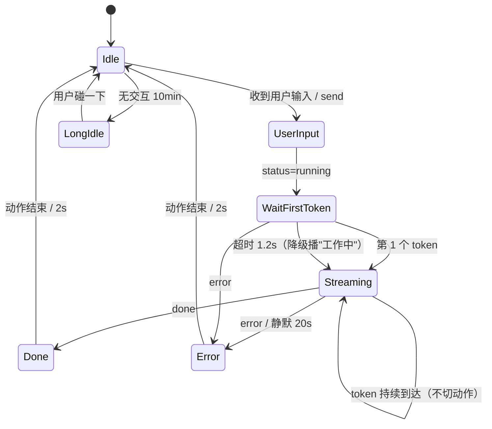

# 动作 × 对话：状态机与状态映射设计

> 本轮已落地：`packs/dsh/state-map.json` + mini 的 `state_map.py` + tauri 的 `main.js` 状态层。
> **用户配置 = 状态映射，不再有关键词/正则**（关键词方案降级为附录 §9.7「已弃用/备选」）。
> 素材现在是 11 段 `dsh_*`（`clips.json` 已全部登记，`defaultIdle=dsh_idle`）。

## 0. 结论（先看这段）

1. **DSH 侧能接**：`dsh-deskpet-bridge` 是一个跑在 `127.0.0.1:55471` 的零依赖 WebSocket 服务，已经能对外广播 `welcome / status / token / done / error`，也能接收 `send / ping`。它**没有**思考中/工具调用/首 token/TTS/中断 这些事件——因为这些帧在 `index.js:306` 就被 `chunk.type === 'text-delta'` 过滤掉了。
2. **驱动方式必须是"阶段变化驱动"**：`token` 每来一个字就切动作一定抽搐，所以只在 `status:running`、`done`、`error`、`超时` 四个边上做转移，`token` 只用来计时（判断"等待首 token"是否超时）。
3. **素材时长决定一切**：最短的循环 4.00s，最长 5.2s，而"等待首 token"经常只有 0.3~0.8s。所以必须引入 `minPlayMs` + "允许被打断" + "只播一次不循环" 三条规则，否则一个 5s 的动作会把后续状态全部压住。
4. **用户配置做状态映射（不做关键词）**：把 10 个可观测状态暴露出来，用户给每个状态选一个动画；匹配逻辑由程序负责，用户不需要写规则。理由见 §9.1。
5. **两个提醒态需要区分可观测性**：`awaiting_user` 纯客户端可派生（本轮已实现）；`needs_decision` 现有 DSH 事件源**无法**观测，需要 DSH 补 `attention` 事件（本轮先用启发式占位，标注不可靠）。

---

## 1. 现状勘察：DSH 侧到底暴露了什么

只读检查了 `dsh-deskpet-bridge/index.js`（未跟踪目录，未修改未提交）与 `harness_bridge_test.mjs`（后者用 mock ctx 把这套协议端到端跑通过）。

### 1.1 已确认（代码里有、harness 里验证过）

| 方向 | 帧 | 触发点 | 备注 |
|---|---|---|---|
| 服务端→宠物 | `{"type":"welcome","origin":"ws://127.0.0.1:55471"}` | 握手成功 | 可用于判断"桥在不在" |
| 服务端→宠物 | `{"type":"status","status":"running"\|"idle"}` | `agent/status` | **唯一可靠的"开始/结束"信号** |
| 服务端→宠物 | `{"type":"token","text":"你"}` | `agent/assistant-stream` 且 `frame.chunk.type==='text-delta'` | 逐字，频率几十 Hz |
| 服务端→宠物 | `{"type":"done"}` | `frame.type==='end'` | 一轮回答结束 |
| 服务端→宠物 | `{"type":"error","message":"..."}` | `agent/error` | 只有字符串，**无错误类型** |
| 宠物→服务端 | `{"type":"send","text":"你好桌宠"}` | 客户端 | 走 `agent.followup()`，等同用户在 DSH 里发消息 |
| 宠物→服务端 | `{"type":"ping"}` → `{"type":"pong"}` | 客户端 | 保活 |

### 1.2 缺失（明确没有，别猜）

| 想要的信息 | 现状 | 结论 |
|---|---|---|
| 思考中（reasoning） | `chunk.type` 非 `text-delta` 的帧被丢弃 | **拿不到** |
| 工具调用执行中 | 没有订阅任何 tool 相关事件；`assistant-stream` 里的 tool 帧同样被丢 | **拿不到** |
| 首 token 时刻 | 只能由"第一个 `token`"推断 | 可派生（见 §3.2） |
| TTS 是否在放 / 音频地址 | 协议里没有 | **拿不到** |
| 中断/停止命令 | 只有 `send`，没有 `stop` | **拿不到** |
| 用户输入原文 | 宿主没广播；宠物自己 `send` 的文本它自己知道 | 半可用（见 §9） |
| 多会话区分 | payload 里没有 `sessionId` | 单会话可用，多会话会串 |
| 错误分类（超时/网络/工具失败） | 只有 `message` 字符串 | 只能按文本关键字猜，不建议 |

### 1.3 要让状态机真正跑起来，DSH 侧最少还要给 3 样东西

1. `phase` 事件：`thinking` / `tool_call` / `tool_result` / `first_token` / `speaking`。
   最小改法：在 `index.js:306` 那个分支上加 `else if (frame.chunk) broadcast({type:'phase', phase: frame.chunk.type})`，把 `tool-call` 之类的帧放出来（字段名沿用 DSH 自己的 chunk type）。
2. `tts` 事件：`{"type":"tts","state":"start"|"end"}`（音频地址可选）。
3. `user_input` 事件：宿主在用户提交时广播 `{"type":"user_input","text":"..."}`，宠物端才能做"用户说的话 → 规则匹配"。

### 1.4 在 DSH 给之前，怎么先跑起来（最小可行桩）

写一个 30 行的本地 WS 桩（协议与 §6 完全一致），定时发假事件即可联调：

```text
t=0.0s  {"type":"status","status":"running"}
t=0.9s  {"type":"phase","phase":"thinking"}      # 桩发，真实 DSH 暂无
t=2.2s  {"type":"token","text":"今"}
t=2.4s  {"type":"token","text":"天"}
t=3.0s  {"type":"done"}
```
这样能在没有 DSH 的情况下验证"阶段驱动 + 仲裁 + 冷却"，且以后换真桥只改 URL。

---

## 2. 现在可控的字段与素材时长

`clips.json` 已登记 4 段（本轮**没有**把 DSMaid 的 4 段登记进去）：

| clipId | 名称 | type | loop | priority | 时长 | 帧数 | 体积 | scale |
|---|---|---|---|---|---|---|---|---|
| `idle` | 待机 | idle | **true** | 0 | 4.00s | 96 | 4.23MB | 1.26 |
| `action` | 挥手 | action | false | 1 | 5.04s | 121 | 4.70MB | 1.26 |
| `action2` | 打字 | action | false | 2 | 4.46s | 107 | 5.06MB | 0.7734 |
| `action3` | 抱臂 | action | false | 3 | 4.46s | 107 | 4.68MB | 0.6942 |

已生成、**未登记**（`frames_dsh_*` + `meta.json` 里已有）：

| clipId | 名称 | 时长 | 帧数 | 体积 | scale |
|---|---|---|---|---|---|
| `dsh_idle` | 待机(新) | 4.00s | 96 | 3.66MB | 0.6827 |
| `dsh_work` | 工作中 | 4.46s | 107 | 5.16MB | 0.7723 |
| `dsh_happy` | 真开心 | 5.04s | 121 | 4.74MB | 0.8643 |
| `dsh_unhappy` | 不高兴 | 4.46s | 107 | 4.72MB | 0.6951 |

关键结论：**现有动作都 ≥4.4s**，且两版都只支持"整段播完/循环"（没有"播前 N 帧"的入口）。所以本轮设计只能靠"打断 + 最短播放时间 + 冷却"来对齐状态时长，不能靠裁帧。

---

## 3. 状态机

### 3.1 状态迁移



ASCII 版本（给不看 Mermaid 的人）：

```text
            ┌────────────────────────── 用户双击/拖拽/右键 ─────────────────────────┐
            ▼                                                                     │
 [Idle] --用户输入--> [UserInput] --status=running--> [WaitFirstToken] --token--> [Streaming]
   │                        │                              │                         │
   │ 无交互>10min            │ error                        │ error / 1.2s 超时        │ done / error
   ▼                        ▼                              ▼                         ▼
 [LongIdle]             [Error]  <------------------- [Streaming 降级] ----------> [Done]
   │                        │                                                        │
   └──── 用户碰一下 ────────┴──── 动作播完 / 2s ─────────────────────────────────────┘
```

### 3.2 各状态最长停留时间与降级

| 状态 | 进入条件 | 最长停留 | 到点后做什么 | 降级动作 |
|---|---|---|---|---|
| `Idle` | 启动 / 任何动作结束 | ∞（正常） | — | `dsh_idle`（默认待机，由 `defaultIdle` 指定） |
| `UserInput` | 收到 `user_input` 或本地 `send` | **1.5s** | 仍没等到 `status:running` → 退回 `Idle` | 不播动作（避免"点了没反应又乱演"） |
| `WaitFirstToken` | `status:running` | **1.2s**（可调 0.6~2.0） | 视为"模型在忙"，播一次长动作 | `dsh_think`（思考状）循环，直到首 token 或 `done/error` |
| `Streaming` | 第 1 个 token | **20s 无新 token** | 判为超时 | `dsh_work`（工作中）循环；超时转 `error` → `dsh_unhappy` |
| `Done` | `done` | 动作时长 + 2s | 回 `Idle`（30s 无输入则进 `awaiting_user`） | `dsh_happy`（真开心） |
| `Error` | `error` 事件 / 超时 | 动作时长 + 2s | 回 `Idle` | `dsh_unhappy`（不高兴）；**不用"炸毛"**——炸毛留给双击的"吃惊" |
| `LongIdle` | `Idle` 持续 10min | ∞ | 只在进入时播一次 | `dsh_yawn`（打哈欠）一次，之后 10min 内不再播 |

> 所有"最长停留"都是**设计值**，实现时放 `rules/timing.json`，别写死在代码里。

---

## 4. 事件 → 动作 映射表

字段说明：`loop` = 是否循环；`minPlayMs` = 最短播放时间（到点前不许被低优先级打断）；`cool` = 冷却秒；`打断` = 能否被更高优先级或用户操作中断。

| 事件 | 首选动作 | 备选 | loop | 优先级 | minPlayMs | cool | 可被打断 | 备注 |
|---|---|---|---|---|---|---|---|---|
| `status:running`（紧接用户输入） | `dsh_work` | `action2` | false | 30 | 1500 | 10 | 是（L3/用户操作） | 只在"进入 running 的边"播一次 |
| `phase:thinking` | "思考状"（未接入） | `dsh_work` | false | 35 | 2000 | 15 | 是 | 需要 DSH 侧先给 `phase` |
| `phase:tool_call` | `dsh_work` | `action2` | false | 40 | 2500 | 20 | 是 | 工具调用是最值钱的信号 |
| `first token`（≥1.2s 才来） | 不播（保持当前） | — | — | — | — | — | — | 已经在播 work 就让它播完 |
| `token`（流式中，2~N 个） | **不播** | — | — | — | — | — | — | 见 §4.1 |
| `done`（一轮结束） | `dsh_happy` | `action` | false | 50 | 1000 | 20 | 是 | 每轮只播一次，避免"多轮连播" |
| `error` | `dsh_unhappy` | `action3` | false | 60 | 1000 | 10 | 否（播完） | 错误要"看完"，被打断会显得没听见 |
| `status:idle`（且无 done） | 不播 | — | — | — | — | — | — | 用户主动取消时常见，静默回待机 |
| 无交互 10min（`LongIdle`） | 打哈欠（未接入） | `action3` | false | 5 | 3000 | 1800 | 是 | 低优先级，任何事件都能打断 |
| 用户双击 | 轮播下一个 action | — | false | 90 | 0 | 1.5 | 否（0.5s 内忽略重复） | 保留现有行为 |
| 用户右键选动作 | 指定 clip | — | false | 95 | 0 | 0 | 否 | 同上 |
| 用户拖拽 | 播放中继续，不换动作 | — | — | — | — | — | — | 拖动不改 clip |

### 4.1 哪些事件**不播**动作（这条比映射更重要）

- **每个 `token`**：一个字一个动作 = 抽搐。只允许在 `WaitFirstToken → Streaming` 的**边上**判断一次（是否已经超时）。
- **`status:running` 的重复事件**：只认上升沿（`idle`→`running`），边沿去重窗口 300ms。
- **`status:idle` 但没 `done`**：视为取消，不播"完成"。
- **同一轮里第二个及以后的 `done`**：一轮只播一次（多轮回答时 `done` 会重复）。
- **`pong` / `welcome`**：纯协议帧。
- **动作进行中到达的任何低优先级事件**：排队丢弃，不切换（宁可漏一个，也不要在 4s 动作中间切 3 次）。

### 4.2 动作时长 vs 状态时长 错配：三条规则

1. `minPlayMs`：动作开始后这段时间内，只有 `priority` 严格更高的请求能打断。默认取"该动作时长的 40%"，但不超过 2500ms（例如 `dsh_happy` 5.04s → 2000ms）。
2. `interruptible`：`error` / 用户显式操作派生出的动作设为 `false`（必须播完），其余 `true`。
3. 没有"补帧"能力时的兜底：**不裁帧、只节流**。等待首 token 只有 0.3s 时不播任何动作（因为播了就得播 1.5s 以上），等 `status:running` 超过 1.2s 才播 `dsh_work`。这条避免"0.3s 等出 4.5s 卡顿"。

> 若以后要支持"只播前 N 帧/只播一段"，在 `clips.json` 加 `segments: {"wait": [0, 48]}`，两版加载器各加 6 行即可；本轮不做。

### 4.3 说话期间（TTS 在放）

现状：**没有 TTS 事件、也没有口型素材**。三个选项与结论：

| 方案 | 做法 | 代价 | 结论 |
|---|---|---|---|
| A. 保持待机 | TTS 期间不播动作，回 `idle` 循环 | 最省，但"人在说话却没反应" | **推荐做默认**（无 TTS 事件时等价于现状） |
| B. 循环一个"说话感"动作 | 用 `dsh_work`（手上动作多）循环 | 语义不对（像在打字不是说话）；4.46s 循环 3 次就机械 | 不推荐 |
| C. 做口型 | 按音素/音量切嘴部帧 | 需要分层素材 + 音频分析，工作量 >> 本轮 | 本轮不做 |

结论：**A 为默认**；等 DSH 侧给出 `tts` 事件后再考虑 B（并且必须是专门的"说话"素材，不能借用工作的）。

---

## 5. 冲突规则 + 仲裁器

### 5.1 优先级总序

```text
用户手动操作(右键选动作 / 拖拽 / Esc)         95   ← 人的直接意志
双击                                         85
单击                                         70
error                                        60
needs_decision（待你决策，提醒态）             55
done                                         45
busy / streaming                             35 / 30
awaiting_user（等你回应，提醒态）              25
long_idle                                    10
idle                                          0
```

数值就是 `state-map.json` 里的 `priority`（0~100）。两条硬规则：
- 高优先级可以抢占低优先级的动作（`interruptible=true` 时）；低优先级想插高优先级一律 `busy` 被拒。
- 用户手动操作永远最高，且享受保护期；提醒态**不打断**用户动作，只在动作结束后才提醒。

用户"刚戳了一下，此时 AI 开始流式输出" → **用户操作优先并享受保护期**：双击产生的动作（priority 85）在 `minPlayMs=1500` 内不会被 `status:running`（30）或 `done`（45）打断；实际表现是"用户戳完，动作播完，再进入工作中"。**不要**在用户点击后的 300ms 内响应任何对话事件（防手抖双触发）。

### 5.2 仲裁器伪代码（10 行，两版照抄）

```python
# 单一入口：所有"想播动作"的请求都走这里；返回 True=已播，False=被拒
def request_play(clip_id, priority, min_play_ms=0, cooldown_s=0, interruptible=True, source="phase"):
    now = mono_ms()
    if now < last_play.get(clip_id, -1e9) + cooldown_s * 1000:      # 同一动作冷却
        return reject(clip_id, "cooldown")
    if cur and now < cur.hold_until and not (interruptible and priority > cur.priority):
        return reject(clip_id, "busy:%s" % cur.clip_id)             # 保护期内只有更高优先级能插
    if cur and not cur.interruptible and now < cur.hold_until:
        return reject(clip_id, "hold:%s" % cur.clip_id)             # 错误/用户动作必须播完
    last_play[clip_id] = now
    cur = Ctx(clip_id, priority, hold_until=now + max(clip_dur_ms(clip_id), min_play_ms),
              interruptible=interruptible)
    start_clip(clip_id)                                             # 播完或打断时 cur=None
    return True
```

配套三条约束（否则仲裁器形同虚设）：
1. `cur` 只在"播完 / 被打断"时清空，**不要**在事件回调里手动改 `cur`。
2. `reject` 必须写进调试环形缓冲（§9.6），不然用户永远不知道为什么没反应。
3. 冷却按 `clipId` 记，不按事件记——同一动作被 5 条规则命中时只受一份冷却约束。

---

## 6. 接口契约（mini 与 tauri 共用）

### 6.1 事件 schema（宿主 → 宠物）

```json
{"v":1,"type":"welcome","origin":"ws://127.0.0.1:55471"}
{"v":1,"type":"status","status":"running","ts":1730800000000}
{"v":1,"type":"token","text":"今","ts":1730800000100}
{"v":1,"type":"done","ts":1730800001200}
{"v":1,"type":"error","message":"tool failed: ENOENT","ts":1730800001300}
```

新增（需要 DSH 侧实现，宠物端要能容忍缺失）：

```json
{"v":1,"type":"phase","phase":"thinking|tool_call|tool_result|first_token","detail":"Read(pet.py)","ts":...}
{"v":1,"type":"tts","state":"start|end","audioUrl":null,"ts":...}
{"v":1,"type":"user_input","text":"我今天好累","ts":...}
```

### 6.2 宠物 → 宿主（已有 / 需新增）

```json
{"type":"send","text":"你好桌宠"}
{"type":"ping"}
```
建议新增 `{"type":"play_clip","clipId":"dsh_unhappy","reason":"user_rule:r_angry"}` 与 `{"type":"state","state":"Streaming"}`（让 DSH 知道宠物在干什么，用于未来 TTS 对齐）。

### 6.3 宿主方法（两版同名同参，4~6 个）

| 方法 | 参数 | 语义 |
|---|---|---|
| `notify(event)` | 上面任一 JSON 对象 | 事件唯一入口，内部只做状态转移判定 |
| `say(text, {durationMs, audioUrl})` | 文本 + 可选时长 | 让宠物"说"，无口型时等价于 `setMood(talking)` + 保持待机 |
| `setMood(mood, {ttlMs})` | `calm/happy/sad/annoyed/tired` | 只影响待机选择与表情后缀，不直接播动作 |
| `interrupt(reason)` | 字符串 | 立刻回 `Idle`，清空排队，`cur=null` |
| `playClip(clipId, {priority, minPlayMs})` | 同 §5.2 | L3 显式指令入口 |
| `getState()` | — | `{state, clipId, since, mood, lastRule}`，给调试面板/DSH 查询 |

字段名刻意不带平台前缀（`state` 而不是 `py_state` / `rs_state`），两版共用一份 JSON；mini 用 `dict`，tauri 用 `serde` 结构体即可。

---

## 7. 降级与缺失素材

| 想要的动作 | 有素材吗 | 降级 1 | 降级 2 | 降级 3 |
|---|---|---|---|---|
| 工作中 / 思考状 | `dsh_work` 已生成**未登记**；思考状未接入 | `action2` 打字 | `action3` 抱臂 | 保持待机（不播） |
| 真开心 | `dsh_happy` 未登记 | `action` 挥手 | 保持待机 | — |
| 不高兴 / 无奈 | `dsh_unhappy` 未登记 | `action3` 抱臂 | 保持待机 | — |
| 炸毛（生气） | **不可用**（黑底非绿幕） | `dsh_unhappy` | `action3` | 不播 |
| 打哈欠 / 看手机 / 吃米饭 / 得意状 | 未接入 | `action3` | 不播（直接跳过久坐事件） | — |
| 说话感 | 无 | 保持待机 | — | — |

规则：**降级链最多 3 层**，第 3 层之后就是"不播"——宁可什么都不做，也不要播一段语义不符的动作。

---

## 8. 亲密度 / 情绪（只定义，不实现）

现状（已核实）：`deskpet-python` **没有任何持久化**——`pet.py` 里没有 SQLite、没有 QSettings，`meta.json`/`clips.json` 只描述素材；尺寸档、当前 clip 都是进程内状态，重启归零。tauri 侧同理（无本地库）。

建议（下一轮实现）：

- 位置：`deskpet-python\state\pet_state.json`（tauri 复用同一路径，两版共读，谁先写谁赢 + 文件锁）。
- 字段：
```json
{"v":1,"affection":60,"mood":"calm","last_seen":"2026-11-05T12:00:00+08:00",
 "counters":{"clicks":12,"conversations":3,"errors":1},"updated_by":"mini"}
```
- 写入时机：**只在状态转移时**写（`done`/`error`/用户交互），不按帧写；节流 ≥5s。
- 情绪只做"表现"的输入（`setMood` → 影响待机选择），不反过来驱动概率；避免"越点越疯"的正反馈。
- 情绪衰减：`affection` 每小时 -1（下限 0），离线 24h 重置 mood 为 `calm`。

---

## 9. 用户配置：状态映射（替代关键词规则）

### 9.1 为什么不做关键词

上一轮设计的是"关键词/正则 → 播动作"，本轮推翻，原因：

- 关键词要用户**写规则**（短语表、否定词、反讽、子串误伤、限流），规则一多就"抽风"，没配的地方就完全不响应；
- 关键词**不可解释**：用户看到动作不知道"它为什么动"，只能翻日志；
- 而真正稳定的信号其实只有 10 个**可观测状态**（模型忙 / 流式中 / 完成 / 出错 / 单击 / 双击 / 待机 / 长待机 / 等回应 / 待决策）。给状态配动画比给句子配动画可靠得多，且没有误触发。

所以：**程序负责状态判定，用户负责"每个状态播哪段"**。关键词那套保留为附录（§9.7），标注「已弃用/备选」，不实现。

### 9.2 文件与加载

| 项 | 约定 |
|---|---|
| 路径 | `packs\<packId>\state-map.json`（内置默认随仓库走；`packId` 现在只有 `dsh`） |
| 双版同源 | `prepare_assets.py --assets` 把它原样复制到 `deskpet-tauri\assets\state-map.json`，**两版读同一份**，字段语义不分叉 |
| 热加载 | 每次 tick（1s）比对 `mtime` + 文件内容；变了才重解析，**去抖 800ms**；解析失败 → 保留上一版 + 提示（mini 用 `QMessageBox`/日志，tauri 用红框 `showHint`） |
| 逐条校验 | 每条规则独立 `try/catch`：`state` 未知 / `clipId` 不在 `clips.json` / `priority` 不在 0~100 / `repeat` 非法 → **只废这一条**并记一笔日志，不废整个文件 |
| 缺文件 | 用内置默认映射（等价于仓库里这份），不报错 |

### 9.3 规则字段

```json
{"state":"needs_decision","clipId":"dsh_helpless","priority":55,"minPlayMs":1200,
 "cooldownSec":0,"loop":false,"interruptible":true,"enabled":true,
 "repeat":{"mode":"interval","intervalSec":75,"maxTimes":3}}
```

| 字段 | 说明 |
|---|---|
| `state` | 10 个状态之一（见 §9.4），写错就整条废 |
| `clipId` | 必须是 `clips.json` 里登记过的 id（`dsh_*`） |
| `priority` | 0~100，见 §5.1；同状态多条时取最高 |
| `minPlayMs` | 最短占用时长，防"刚起播就被下一状态打断" |
| `cooldownSec` | 同一 clip 的冷却；`0` = 不冷却 |
| `loop` | 是否循环播放（长时间状态用 `true`，一次性动作用 `false`） |
| `interruptible` | `false` 时该动作必须播完（用于"必须被看见"的动作） |
| `enabled` | 关掉某状态：该状态不播任何动作，画面保持当前 |
| `repeat` | **只有两个提醒态会用**；其它状态写了 `interval` 直接忽略（按 `once` 处理） |

### 9.4 10 个状态与默认映射（推荐值）

| 状态 | 含义 | 可观测性 | 默认 clip | prio | loop / repeat | minPlay / cooldown |
|---|---|---|---|---|---|---|
| `idle` | 待机 | 默认 | `dsh_idle` | 0 | loop | 0 / 0 |
| `long_idle` | 长待机（10min 无交互） | 客户端计时 | `dsh_yawn` | 10 | once | 0 / 600s |
| `awaiting_user` | done 后 30s 用户没再输入 | **纯客户端派生** | `dsh_phone` | 25 | once | 0 / 0 |
| `streaming` | 流式输出中 | `token` | `dsh_work` | 30 | loop | 0 / 5s |
| `busy` | 模型在忙、尚无首 token | `status=running` | `dsh_think` | 35 | loop | 0 / 0 |
| `done` | 本轮完成 | `done` | `dsh_happy` | 45 | once | 1200 / 0 |
| `needs_decision` | 需要用户确认/选择 | **DSH 缺事件**（见 §9.5） | `dsh_helpless` | 55 | interval 75s × 3 | 1200 / 0 |
| `error` | 出错 | `error` / 流式超时 | `dsh_unhappy` | 60 | once | 0 / 30s |
| `click` | 单击 | 本地鼠标 | `dsh_proud`（得意） | 70 | once | 0 / 3s |
| `double_click` | 双击 | 本地鼠标 | `dsh_shock`（炸毛） | 85 | once | 0 / 8s |

**为什么 `streaming` 用 `工作中`（`dsh_work`）而不是 `看手机`**：流式可能持续几十秒到几分钟，`看手机` 传达的是"它在摸鱼"，和"模型正在输出"语义相反，用户会误判它没在干活。`工作中` 的敲键盘动作正好对应输出，且是 107 帧/4.46s 的循环，边界自然。**风险**：长循环看久了吵——缓解办法是每 3 个循环插 1 个待机循环（本轮未实现，写进限制）。若用户喜欢更安静，把这一行改成 `dsh_phone` + `repeat` 即可，不需要改代码。

**为什么 `busy` 用 `思考状`**：等待首 token 时它应该"看起来在想办法"，而不是"在敲键盘"（还没有输出）。

**为什么 `awaiting_user` 只播一次**：它是"提醒你一句"，不是"持续骚扰"。播完回到低频待机，进入 `long_idle` 后不再重复。

**为什么 `needs_decision` 用 `无奈状` 而不是 `炸毛/不高兴`**：`needs_decision` 是"等你拍板"，不是"出错了"。用炸毛/生气会让用户以为程序崩了或宠物在发脾气，反而去排查故障；`无奈状`（摊手耸肩）语义是"你决定吧"，幅度大、容易注意到，且不带负面情绪。`error` 才用 `dsh_unhappy`。

### 9.5 两个提醒态的实现要点（与其它 8 个不同）

**`awaiting_user`（等你回应）—— 本轮可实现，不需要 DSH 改代码**

- 进入：`done` 事件后启动计时器，`awaitingUserSec`（默认 30s，可配）内没有新的 `user_input` → 进入。
- 播放：`repeat.mode="once"` → 播一次（默认 `看手机`，4.6s），播完回待机；**不常驻循环**。
- 退场：用户任何输入 → 立刻 `busy`（`onUserInput` 清提醒）；进入 `long_idle` → 不再提醒（一次性标记 `silenced`）。
- 优先级 25：低于 `streaming/busy`（不能抢正在输出的画面），高于 `long_idle`。

**`needs_decision`（待你决策）—— 需要 DSH 改代码**

- 现状：DSH 只广播 `welcome/status/token/done/error`，**没有任何"等待用户确认/选择"的信号**，所以本轮用**启发式占位**：`done` 之后如果 AI 回复末尾是 `?/？`、或包含 `1. 2. 3.` / `[ ]` / `是否` / `要不要` 等选项特征 → 进入 `needs_decision`。**这个启发式不可靠**（反问句、教程里的列表都会误触发），默认 `enabled:false`，只在用户显式打开时生效。
- 需要 DSH 补的事件（建议 schema，和现有事件同一条 WS 通道）：
  ```json
  {"v":1,"type":"attention","kind":"confirm|choice|approval",
   "prompt":"是否继续写入 3 个文件？","options":["继续","取消"],"timeoutSec":300,"ts":1730800000000}
  ```
  用户响应后再发 `{"type":"attention_clear","ts":...}`，宠物据此清除提醒。
- 播放：一次明显动作（`dsh_helpless`，`minPlayMs=1200`）→ 之后每 `intervalSec`（默认 75s，可配 60~90）**轻微提醒一次**（当前实现是重播同一个动作，后续可换成"汗滴/气泡"叠加层）；`maxTimes=3`。
- 退场（必须写死，否则会卡在提醒态）：
  1. 用户响应（`user_input` / `attention_clear`）→ 清除，回 `busy`；
  2. 超时（DSH 的 `timeoutSec`，没给就用 **300s**）→ 清除，回 `idle`；
  3. 用户手动操作（双击 / 右键）→ 立即清除；
  4. 提醒次数上限 3 次——到顶后**停在最后一次的画面，不再重播**，但不退出状态（等上面 1~3 的任一条）。
- 优先级 55：高于 `done/streaming/busy/idle`，低于 `click/double_click` 等手动操作。

**与 `error` 的区分（必须守住）**：`error` = "出错了"，动作是负面情绪（不高兴），节奏是一次性；`needs_decision` = "等你说话"，动作是中性/摊手，节奏是"一次 + 低频轻提醒"。两者混用会让用户把"等待确认"误读成"程序故障"。

**亲密度联动**：本轮实现里**没有亲密度/好感度能力**（`pet.py`/前端都没有该字段），所以标为**待做**。产品判断先写死在这里：用户响应 `needs_decision` → 计正向；提醒超时**不计负向**（不能因为用户没回应就掉好感）。

### 9.6 调试与拒绝原因

- 环形缓冲最近 **20 条**，每条形如：
  `当前状态 -> 命中规则(clipId/priority) -> 播放 | 被拒(disabled / cooldown / busy:<clipId> / hold)<理由>`
- mini：`--log` 文件 + `state_map.py` 的 `_dbg`；tauri：`window.__deskpetLog()`（浏览器控制台/DevTools 可看），日志同时带 `state` 字段。
- 关键拒绝语义：`busy` = 有更高优先级动作在占用（含 `holdUntil` 保护期）；`cooldown` = 同一 clip 冷却未到；`disabled` = 该条 `enabled:false`。

### 9.7 附录：关键词/正则方案（已弃用 / 备选）

> 以下是上一轮的关键词设计，**本轮不实现**。保留原因是：万一以后要"用户说什么就播什么"，这份 schema 和踩坑表可以直接拿来用。它不能替代状态映射，只能作为 `state` 之外的额外触发源。

### 9.7.1 规则 schema（历史）

```json
{
  "version": 1,
  "defaults": {"cooldownSec": 30, "minPlayMs": 1200, "globalMinGapSec": 2, "perMinuteMax": 4},
  "rules": [
    {
      "id": "r_unhappy_words",
      "enabled": true,
      "scope": "user",
      "match": {"type": "phrases", "any": ["不高兴", "烦死了", "气死我了"], "avoid": ["不是", "没有", "别"]},
      "clipId": "dsh_unhappy",
      "priority": 70,
      "cooldownSec": 30,
      "minPlayMs": 1200,
      "oncePerSession": false,
      "moodImpact": -1,
      "note": "用户明确表达负面情绪时播不高兴"
    },
    {
      "id": "r_praise",
      "enabled": true,
      "scope": "assistant",
      "match": {"type": "phrases", "any": ["搞定了", "完成了", "全部通过", "跑通了"]},
      "clipId": "dsh_happy",
      "priority": 65,
      "cooldownSec": 60,
      "minPlayMs": 1000,
      "oncePerSession": true,
      "moodImpact": 2
    },
    {
      "id": "r_phone",
      "enabled": true,
      "scope": "both",
      "match": {"type": "phrases", "any": ["看手机", "刷手机", "玩手机"], "minLen": 3},
      "clipId": "dsh_phone",
      "priority": 40,
      "cooldownSec": 120,
      "minPlayMs": 1200,
      "moodImpact": 0
    },
    {
      "id": "r_hungry",
      "enabled": false,
      "scope": "user",
      "match": {"type": "phrases", "any": ["饿了", "好饿", "吃点东西", "外卖"]},
      "clipId": "dsh_rice",
      "priority": 45,
      "cooldownSec": 180,
      "minPlayMs": 1500,
      "moodImpact": 0,
      "note": "素材未接入，默认关闭"
    },
    {
      "id": "r_debug_regex",
      "enabled": false,
      "scope": "both",
      "match": {"type": "regex", "pattern": "^/?(怒|气)"},
      "clipId": "dsh_angry",
      "priority": 80,
      "cooldownSec": 300,
      "minPlayMs": 2000,
      "moodImpact": -2,
      "note": "炸毛素材不可用，示例只展示正则写法"
    },
    {
      "id": "r_work_tool",
      "enabled": true,
      "scope": "assistant",
      "match": {"type": "phrases", "any": ["正在执行", "调用工具", "稍等"]},
      "clipId": "dsh_work",
      "priority": 55,
      "cooldownSec": 90,
      "minPlayMs": 2000,
      "moodImpact": 0
    }
  ]
}
```

字段语义（缺一不可，少一个就会出现"为什么它突然动了"）：

| 字段 | 说明 |
|---|---|
| `scope` | `user`=只匹配用户说的话 / `assistant`=只匹配 AI 回复 / `both`=两者（**默认必须显式写**，不给默认值） |
| `match.type` | `phrases`（词组精确包含）/ `regex` / `mood`（预留，未实现） |
| `match.avoid` | 命中句子里出现这些词就放弃（否定词前置窗口用默认 `["不","没","别","无","非"]`） |
| `priority` | 与 §5 的优先级同一套数值；规则层建议 40~80，别越过对话阶段事件（≥50 是给 done/error 的） |
| `minPlayMs` | 最短播放时间，`0` 也可但会被立刻打断 |
| `cooldownSec` | 同一 `clipId` 的冷却；`oncePerSession` 是它之上的一次性开关 |
| `moodImpact` | `-3~3`，默认 `0`；只影响亲密度，不改变动作强度 |

### 9.7.2 关键词匹配的天坑与对策（历史）

| 坑 | 例子 | 对策（可直接实现） |
|---|---|---|
| 否定 | "我**不**高兴" 命中 "不高兴" | 命中位置前 6 字内出现否定词（`不/没/没有/别/无/非`）→ 放弃；`avoid` 里显式再加也行 |
| 反讽 | "太厉害了，又崩了" | L1 **认不出**。要么不配这类词，要么接受误触发；不要试图用正则解决 |
| 子串误伤 | "手机上有个 bug" 命中 "手机" | 规则用**词组**（"看手机/刷手机"），`minLen ≥ 3`；禁止单字/双字裸匹配（"好""对""行"一律不允许入库，加载时直接拒） |
| 高频词淹没 | "好"、"对" | 硬性限流：`cooldownSec ≥ 60` + 全局 `perMinuteMax=4` + `globalMinGapSec=2` |
| 多规则同时命中 | 同一句命中 3 条 | 排序：`priority` 降序 → **命中词长度降序** → 规则声明顺序。理由见下 |
| 状态冲突 | 正在流式输出时用户又说了一句 | 规则命中也走仲裁器（§5.2），`priority<80` 不许打断 `holdUntil` 内的动作；用户新输入只把状态拉回 `WaitFirstToken`，不立刻播规则动作 |

**为什么"最长匹配优先"比"先配置的优先"更合理**：命中词越长，信息量/特异性越高（"看手机"比"手机"更接近真实意图）。而"先配置的优先"把优先级绑在**编辑顺序**上——用户追加一条新规则会意外压掉旧规则，行为不可预测，且没法解释。落地上仍以 `priority` 为主序，长匹配只做同 priority 内的次序。

### 9.7.3 三层方案对比与推荐（历史结论：L1 已弃用）

| 层 | 能力 | 成本 | 风险 | 结论 |
|---|---|---|---|---|
| **L1 关键词/正则** | 确定、可解释、零延迟、用户能自己改 | 0 | 不懂上下文、否定/反讽误触发 | **默认必须有** |
| **L2 小模型/嵌入/LLM 情绪标签** | 能懂"今天累死了" | 装模型、100ms~2s 延迟、内存 +200MB~2GB | 误触发且**不可解释**（用户无法回答"你为什么做这个动作"）；桌宠是常驻低频交互，误触发的伤害 > 漏触发的收益 | **本轮不做** |
| **L3 显式指令**（AI 调 `play_clip`，或用户说"做个不高兴的动作"） | 最准，语义明确 | 需要 LLM 支持工具调用；需要 DSH 侧加一条 `play_clip` 通道 | 依赖模型能力 | **可选增强**，作为 L1 之上的"最高优先级" |

**优先级仲裁总序（最终版）**：

```text
L3 显式指令  >  对话阶段事件（done/error/tool_call）  >  用户规则 L1  >  随机待机/久坐
```

注意用户**手动**交互（双击/右键/拖拽）不在这条链里，它是"人的直接意志"，永远凌驾于上面所有自动来源（§5.1）。

### 9.7.4 用户在哪里配、怎么配（历史）

| 项 | 方案 |
|---|---|
| 文件位置 | `deskpet-python\rules\actions.json`（**内置**，随仓库走，只读）；`%APPDATA%\deskpet\rules\user.json`（**用户**，可写，覆盖/追加内置）。两份都加载，按 `id` 去重，用户版优先 |
| 热加载 | `QFileSystemWatcher`（mini）/ `notify` crate（tauri）监听 user 文件；**去抖 800ms**；解析失败 → 保留上一版 + 状态提示，不重启进程 |
| 配置界面最小形态 | 一个列表：每行 `[开关] 关键词 | 动作(下拉，选项来自 clips.json 已登记项) | 优先级(数字) | 冷却(秒) | [删除]`；底部 `[新增] [保存并生效]`。**不做可视化流程图/节点编辑器** |
| 校验 | 逐条 `try/catch`：`clipId` 不在 clips.json → 该条禁用并提示"规则 r_phone：clipId 'dsh_phone' 不存在，可用：idle/action/action2/action3"；正则编译失败 → 该条禁用并提示具体位置；`priority` 越界（<0 或 >100）→ 该条禁用。**一条坏规则只废自己，不废整个文件** |
| 冲突提示 | 同 `clipId` 且同 `priority` 的两条规则 → 警告"优先级相同，按声明顺序生效，建议合并"，但**不阻断**加载 |
| 调试模式 | 环形缓冲最近 **20 条**：`{time, event, text片段, ruleId, 结果: played|reject(busy/cooldown/disabled/scope)}`；入口：右键菜单 →「调试：最近命中」，或 `DESKPET_RULE_TRACE=1` 时写 `logs/rules.jsonl`。**这是用户调规则唯一可行的手段** |

### 9.7.5 安全与体验边界

- 动作**不是惩罚**：所有 clip 只做"表现"，禁止任何"因为说了某句话就被冷落/变凶"的语义。给每条规则 `moodImpact`（`-3~3`，默认 0），由 `mood` 决定待机选择，而不是直接播"凶"的动作。
- 误触发成本 > 漏触发：默认关闭所有"语义强"的规则（吃米饭/炸毛示例都 `enabled:false`），只开 4~6 条最稳的。
- 滥用风险：用户写一堆规则（比如 30 条）会让桌宠"抽风"——对策是**全局速率限制**（`perMinuteMax=4`、`globalMinGapSec=2`）+ 配置界面显示"今日触发次数"，超过阈值给一次性提示"规则太密，已自动降频"。
- 不读隐私文本做统计：调试缓冲只存**命中片段**（前后各 6 字），不落盘完整对话，`logs/rules.jsonl` 默认关闭。

---

## 10. 需要用户拍板的三个决策

1. **`streaming` 播什么**：本轮默认 `工作中`（语义一致，但长循环略吵）；备选 `看手机`（安静，但容易误读成摸鱼）。改法：`state-map.json` 里改那一行的 `clipId`。
2. **`needs_decision` 要不要开启发式**：默认 `enabled:false`（等 DSH 补 `attention` 事件）。要现在就能看到提醒效果，把它改成 `true`，但会误触发。
3. **`error` 播「不高兴」还是「炸毛」**：默认不高兴（炸毛留给双击的"吃惊"）；如果用户希望出错更显眼，把 `error` 换成 `dsh_shock`。

## 11. 实施顺序（本轮已完成的部分打勾）

1. ✅ 11 段登记进 `clips.json`（`defaultIdle=dsh_idle`）。
2. ✅ 状态映射层：`state-map.json` + mini `state_map.py` + tauri `main.js`（10 状态、三道闸、提醒态、20 条调试日志）。
3. ⬜ DSH 侧 `attention` 事件 + `attention_clear`（本轮缺，`needs_decision` 只能用启发式占位）。
4. ⬜ 亲密度/好感度（本轮代码里没有该能力）。
5. ⬜ 提醒提醒的"轻量叠加"（汗滴/气泡）——现在是重播动作。
6. ⬜ 长循环降噪（`streaming` 每 3 个循环插一次待机）。
